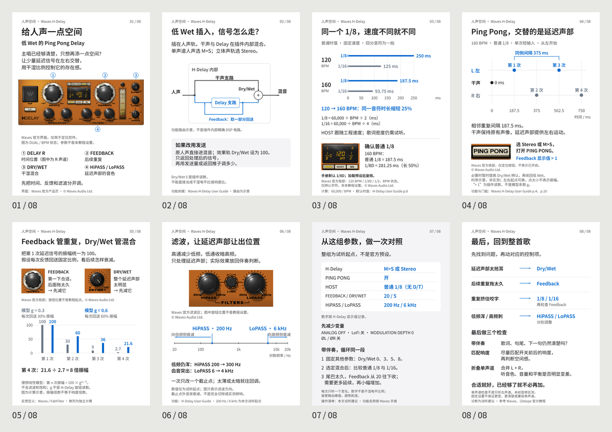
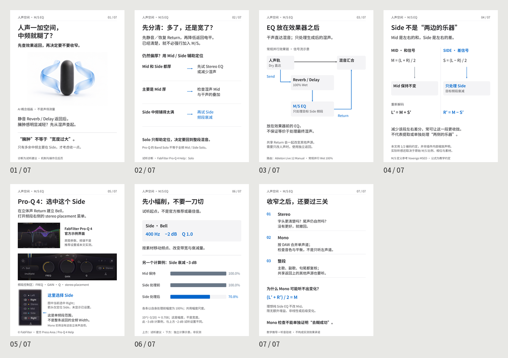
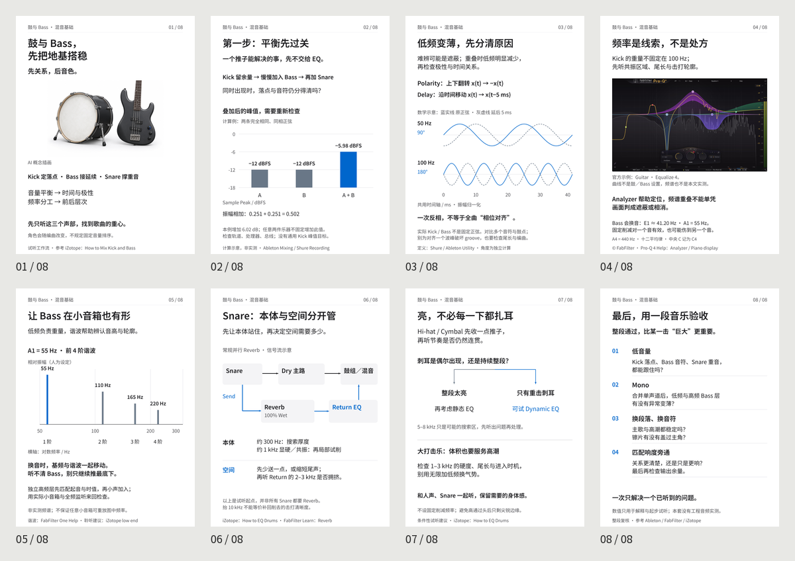

# Music Mixing Secrets

**Kangdi Wang · 2026**

中文混音教学图文、详细图解研究报告与可编辑源码。每帖独立归档，包含公开证据、推导、素材、设计方案、发布文案和最终导出；以可复核的原理和有条件的试听建议替代固定配方。

## 帖子索引

### 1. [低 Wet 人声 Ping Pong Delay](posts/delay-v3/)

[](posts/delay-v3/)

8 页 · [研究报告](posts/delay-v3/RESEARCH_REPORT.md) · [PDF](posts/delay-v3/source/output/vocal-delay-v3.pdf) · [PNG](posts/delay-v3/source/output/) · [文案](posts/delay-v3/source/public_caption.txt)

### 2. [人声空间与 Side EQ](posts/ms-return/)

[](posts/ms-return/)

7 页 · [研究报告](posts/ms-return/RESEARCH_REPORT.md) · [PDF](posts/ms-return/source/output/vocal-side-eq.pdf) · [PNG](posts/ms-return/source/output/) · [文案](posts/ms-return/source/publish-caption.txt)

### 3. [鼓与 Bass：先把地基搭稳](posts/drums-bass/)

[](posts/drums-bass/)

8 页 · [研究报告](posts/drums-bass/RESEARCH_REPORT.md) · [PDF](posts/drums-bass/source/output/drums-bass.pdf) · [PNG](posts/drums-bass/source/output/) · [文案](posts/drums-bass/source/caption.txt)

## 历史迭代

Delay 的早期版本也单独保留：[V1 · 7 页](history/delay-v1/) · [V2 · 8 页](history/delay-v2/)。它们用于回看制作演进，当前版本仍为 V3。原始 HTML、PNG、PDF 与文案均保留；未找到的独立历史研究报告明确列入各版本说明。

## 档案结构

- posts/<topic>/README.md：单帖入口
- posts/<topic>/RESEARCH_REPORT.md：详细、带图的研究与创作论证
- posts/<topic>/source/：原始内容稿、设计稿、HTML、JSON、SVG、字体、脚本、导出文件
- history/：已找回的历史迭代，与主索引的现行版本分开
- [工作流程](WORKFLOW.md)：面向后续新增帖子的公开制作检查表
- [版本记录](CHANGELOG.md) · [档案范围](ARCHIVE_NOTES.md) · [权利说明](RIGHTS.md)

## 使用说明

可直接阅读研究报告与 PDF，或下载源码离线查看 HTML。数学图和参数起点不是真实音频测量。产品原图仅用于说明实际界面，不声称截图已应用教程参数。每帖来源与素材记录说明适用范围及限制。

本仓库是混合权利档案，没有对全部文件作统一的宽松授权。衍生 HTML/CSS 保留 AGPL-3.0，Noto 字体保留 SIL OFL，设计参考保留其 MIT 许可；产品界面、商标与未特别授权的原创作品保留各自权利。请先阅读 [RIGHTS.md](RIGHTS.md)。

## 完整性检查

运行 python scripts/verify_archive.py 可离线检查保留成品的 SHA-256、研究报告配图和 Python 语法。当前三帖在临时副本中通过构建与渲染检查（8 / 7 / 8 页，1080 × 1440）；这不等于跨平台像素一致性保证。

## 增量整理约定

新增帖子使用独立稳定目录，更新本索引与 CHANGELOG，不覆盖已批准的最终版本。已有帖子的实质修订进入带版本标识的目录，并注明变更理由和替代关系。不要把旧版本误标为当前推荐版本。

## 引用 / Citation

```bibtex
@misc{wang2026musicmixingsecrets,
  author = {Wang, Kangdi},
  title = {Music Mixing Secrets},
  year = {2026},
  howpublished = {GitHub repository},
  url = {https://github.com/DDDPG/music-mixing-secrets},
  note = {Illustrated mixing tutorials, research reports, and editable source}
}
```

独立文件：[CITATION.bib](CITATION.bib)。引用具体结论时，也请标明对应帖子和其中的一手资料。
