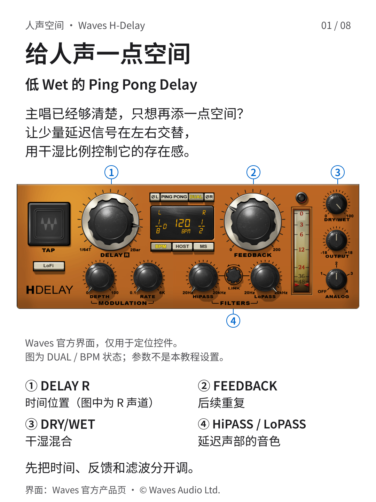
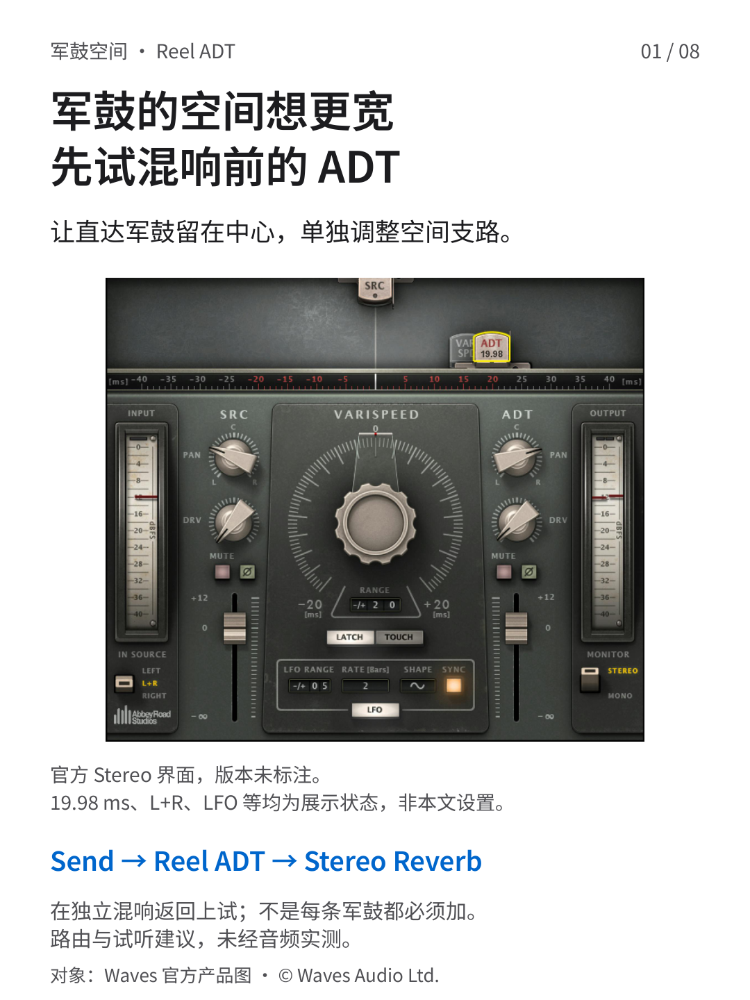
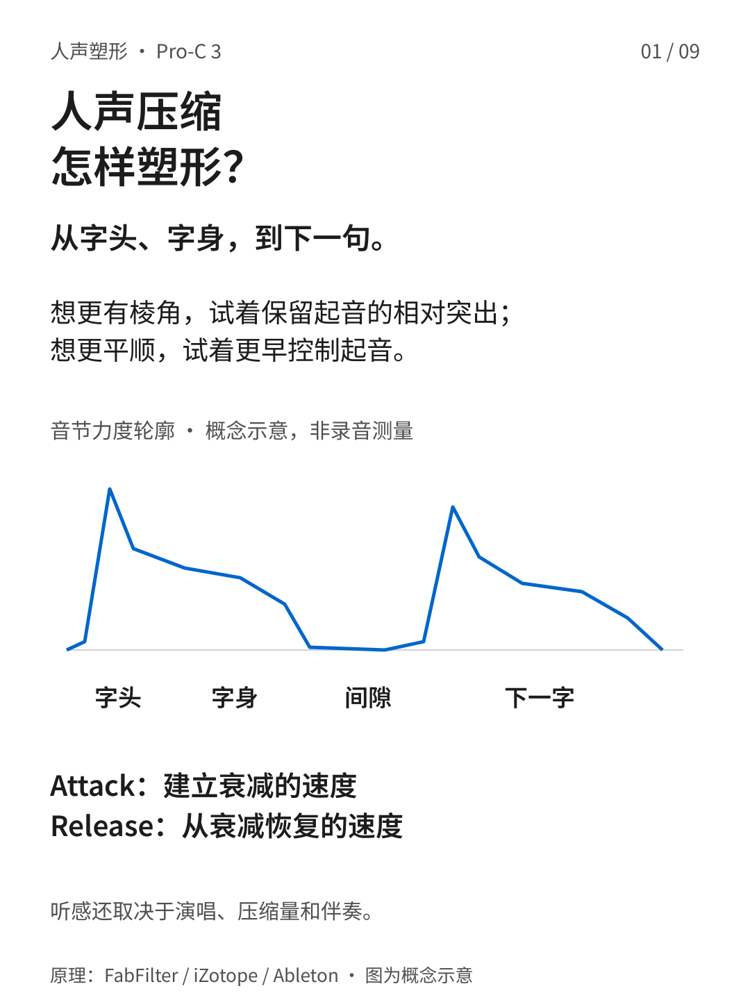
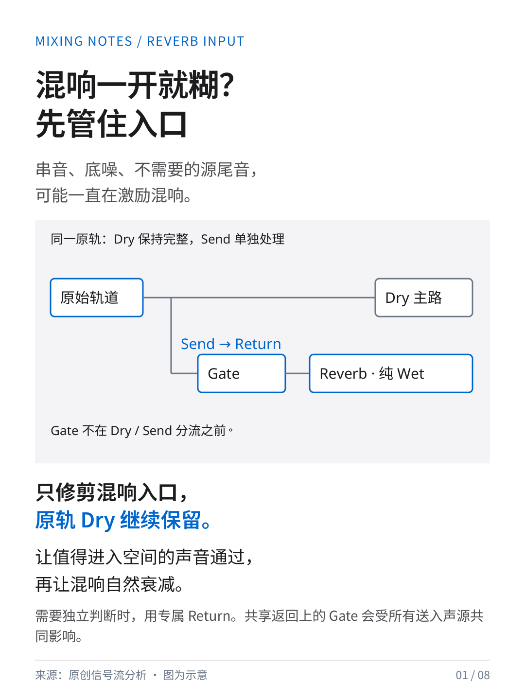

# Music Mixing Secrets

**用图解拆开混音问题，用试听做出判断。**

写给正在学习人声处理、节奏组混音与合成器空间安排的音乐人。这里收录中文图文教程、详细研究报告与可编辑源码，从信号路由和参数含义出发，理解每一步在改变什么。

## 图文教程

点击封面进入专题，或从下方直接阅读报告与完整图文。

<p>
  <a href="posts/delay-v3/"></a>
  <a href="posts/ms-return/"></a>
  <a href="posts/drums-bass/"></a>
</p>
<p>
  <a href="posts/snare-adt-before-reverb/"></a>
  <a href="posts/vocal-compression-shaping/"></a>
  <a href="posts/synth-placement/"></a>
</p>

<p>
  <a href="posts/gate-before-reverb/"></a>
  <a href="posts/kick-saturation/"></a>
  <a href="posts/fx-priority/"></a>
</p>

### 01 · 给人声一点空间

低 Wet 的 Ping Pong Delay：把延迟时间、反馈、干湿混合与滤波分开理解，控制重复声的节奏与存在感。

[研究报告](posts/delay-v3/RESEARCH_REPORT.md) · [完整图文 PDF](posts/delay-v3/source/output/vocal-delay-v3.pdf) · [逐页图片](posts/delay-v3/source/output/) · [HTML 源码](posts/delay-v3/source/index.html)

### 02 · 人声空间与 Side EQ

加上空间后中频变糊？从效果返回查起，理解 M/S 的和差关系，以及何时值得尝试局部 Side EQ。

[研究报告](posts/ms-return/RESEARCH_REPORT.md) · [完整图文 PDF](posts/ms-return/source/output/vocal-side-eq.pdf) · [逐页图片](posts/ms-return/source/output/) · [HTML 源码](posts/ms-return/source/index.html)

### 03 · 鼓与 Bass，先把地基搭稳

从 Kick、Bass 与 Snare 的关系出发，依次检查音量平衡、时间与极性、频率分工和前后层次。

[研究报告](posts/drums-bass/RESEARCH_REPORT.md) · [完整图文 PDF](posts/drums-bass/source/output/drums-bass.pdf) · [逐页图片](posts/drums-bass/source/output/) · [HTML 源码](posts/drums-bass/source/index.html)

### 04 · 军鼓混响前的 ADT 拓宽

在独立空间支路中，把 ADT 放在混响前：分清 ADT 与 Predelay，检查立体声输入、干声保留和完整链路的单声道兼容性。

[研究报告（6 页）](posts/snare-adt-before-reverb/research/RESEARCH_REPORT.pdf) · [完整图文 PDF（8 页）](posts/snare-adt-before-reverb/output/snare-adt-before-reverb.pdf) · [逐页图片](posts/snare-adt-before-reverb/output/) · [HTML 源码](posts/snare-adt-before-reverb/index.html)

### 05 · 人声压缩怎样塑形

从字头、字身到下一音节，拆开 Attack 与 Release 的作用；结合简化增益衰减模型和真实控件，建立响度匹配的比较方法。

[研究报告（7 页）](posts/vocal-compression-shaping/output/RESEARCH_REPORT.pdf) · [完整图文 PDF（9 页）](posts/vocal-compression-shaping/output/vocal-compression-shaping.pdf) · [逐页图片](posts/vocal-compression-shaping/output/) · [HTML 源码](posts/vocal-compression-shaping/index.html)

### 06 · 合成器的前后左右

把 Pan、Stereo Width 与前后层次分开判断，理解混响、Predelay 与发送路由，并用单声道检查验证自己的空间安排。

[研究报告（9 页）](posts/synth-placement/output/合成器的左右宽度与前后层次_研究报告.pdf) · [完整图文 PDF（12 页）](posts/synth-placement/output/合成器的前后左右_图文.pdf) · [逐页图片](posts/synth-placement/output/) · [HTML 源码](posts/synth-placement/index.html)

### 07 · 混响入口门限

把门限放在混响前，理解检测、Attack、Hold、Release 与迟滞怎样控制进入空间的信号；分清入口清理和切断混响尾音。

[研究报告（5 页）](posts/gate-before-reverb/research/RESEARCH_REPORT.pdf) · [完整图文 PDF（8 页）](posts/gate-before-reverb/output/gate-before-reverb.pdf) · [逐页图片](posts/gate-before-reverb/output/) · [HTML 源码](posts/gate-before-reverb/source/index.html)

### 08 · 底鼓不够扎实，先别只加音量

分清增益、谐波与瞬态，通过解析模型理解饱和、峰均比和过采样，再用输出补偿与混音内试听判断是否值得保留。

[研究报告（8 页）](posts/kick-saturation/output/research-report.pdf) · [完整图文 PDF（10 页）](posts/kick-saturation/output/kick-saturation.pdf) · [逐页图片](posts/kick-saturation/output/) · [HTML 源码](posts/kick-saturation/index.html)

### 09 · FX 出场，谁该让位？

先安排特效的前后层次，再判断是否需要静态让位或侧链压低；用增益、路由和时间示意理解处理边界。

[研究报告（9 页）](posts/fx-priority/output/research-report.pdf) · [完整图文 PDF（9 页）](posts/fx-priority/output/carousel.pdf) · [逐页图片](posts/fx-priority/output/) · [HTML 源码](posts/fx-priority/index.html)

## 怎么使用

- **先看图文**：用 PDF 或逐页图片了解主题，再带着具体问题阅读研究报告。
- **再查原理**：报告附有图解、计算与来源，区分产品功能、数学示意和试听建议。参数只作为尝试的起点，请放回自己的歌曲中比较。
- **需要编辑**：下载仓库，保留各专题完整的文件结构，再按专题说明打开 `index.html`；修改与导出方法见各专题说明。

## 引用

```bibtex
@misc{wang2026musicmixingsecrets,
  author = {Kangdi, Wang},
  title = {Music Mixing Secrets},
  year = {2026},
  howpublished = {GitHub repository},
  url = {https://github.com/DDDPG/music-mixing-secrets},
  note = {Illustrated mixing tutorials, research reports, and editable source}
}
```

[下载 BibTeX](CITATION.bib) · 引用具体结论时，请同时注明对应专题及其原始来源。

<details>
<summary>更多文档与历史版本</summary>

[历史版本](history/) · [制作流程](WORKFLOW.md) · [版本记录](CHANGELOG.md) · [档案说明](ARCHIVE_NOTES.md)

</details>

素材与源码适用不同的授权条款，转载或修改前请阅读[版权与许可说明](RIGHTS.md)。

