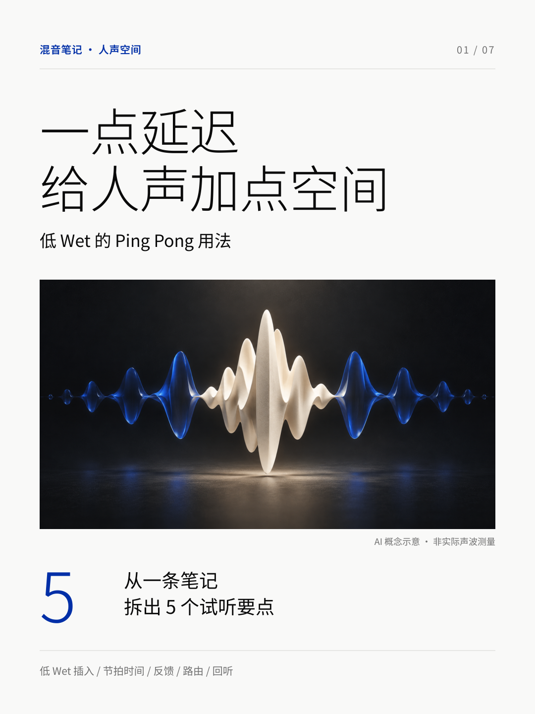

# Delay V1 — historical revision

Seven-page first iteration, preserved as delivered for version history. The current approved version is [Delay V3](../../posts/delay-v3/). V1's original mixing-note narrative and date are intentionally left unchanged; the later V3 develops a self-contained technical explanation without that framing.

- [Original HTML](source/index.html) · [Original PDF](source/output/一点延迟-七页图文.pdf) · [Original PNGs](source/output/)
- [Caption](source/发布文案.txt) · [Sources](source/SOURCES.md) · [Original README](source/README.txt)

Final HTML, PNGs and PDF are byte-identical to recovered originals. The renderer was adapted only to use installed dependencies instead of a machine-specific import path. The historical PDF has its original downloaded filename; running render.py produces vocal-pingpong-delay.pdf.

No standalone detailed illustrated pre-production report, coordinate JSON or separate diagram SVG set was present in this historical bundle. The HTML is the editable source; its embedded styles and text remain available. Consult the later V3 report for the expanded research rationale without assuming that rationale existed in V1.
