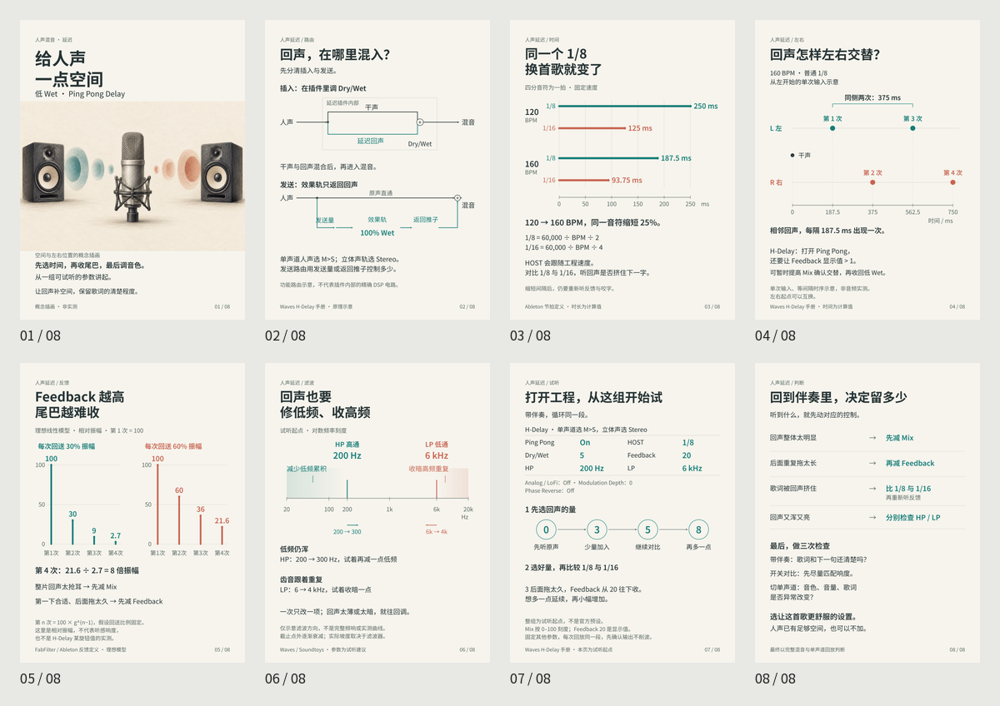

# Delay V2 — historical revision

Eight-page earlier design, retained for comparison and reproducibility. The current approved version is [Delay V3](../../posts/delay-v3/). V2 is not the latest recommendation.

- [Original HTML](source/index.html) · [Original PDF](source/output/vocal-delay-v2.pdf) · [Original PNGs](source/output/)
- [Caption](source/public_caption.txt) · [Sources](source/sources.txt) · [Diagram data](source/diagram_data.json) · [Source diagrams](source/source_diagrams/)
- [Original source README](source/README.txt) · [Third-party notices](source/THIRD_PARTY_NOTICES.txt)

Final HTML, PNGs and PDF are byte-identical to recovered originals. Only the supporting build/render scripts were adapted to use installed dependencies and the bundled HTML seed rather than machine-specific directories. Original instructions mention phone previews, but those preview files were not present in the recovered source/publishing bundle; run render.py on a copy to regenerate them. See the current V3 detailed research report for the expanded, later rationale; no contemporaneous V2 detailed illustrated report was recovered.
