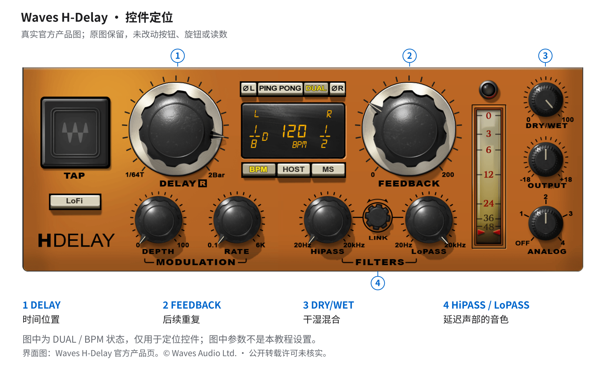
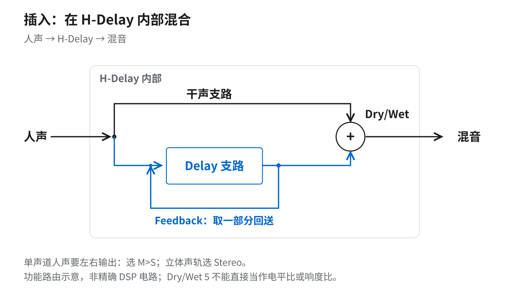
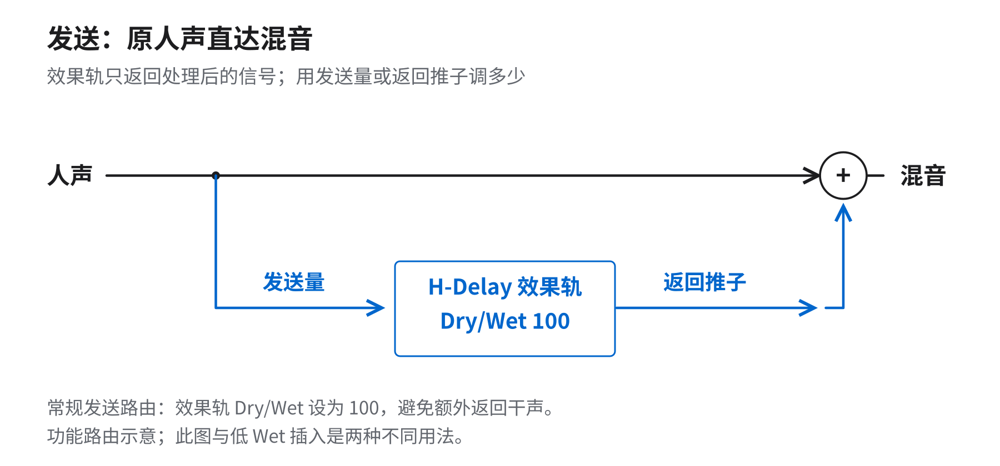
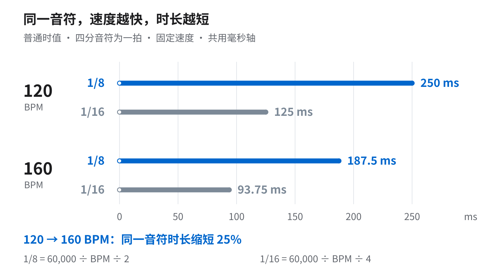
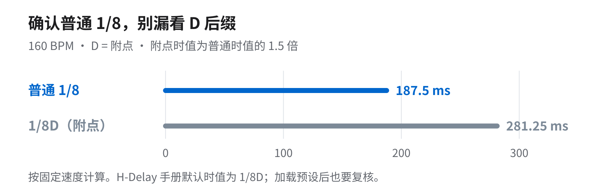
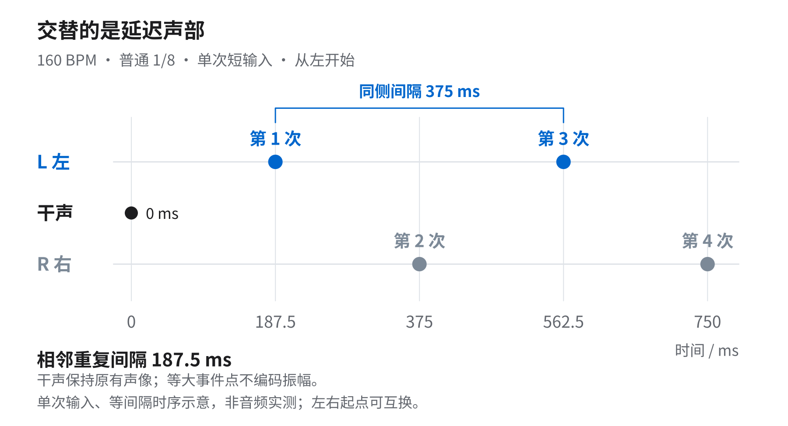
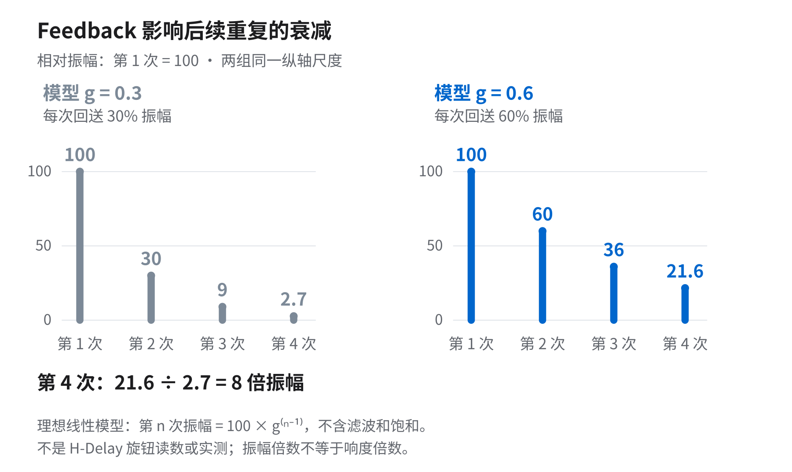
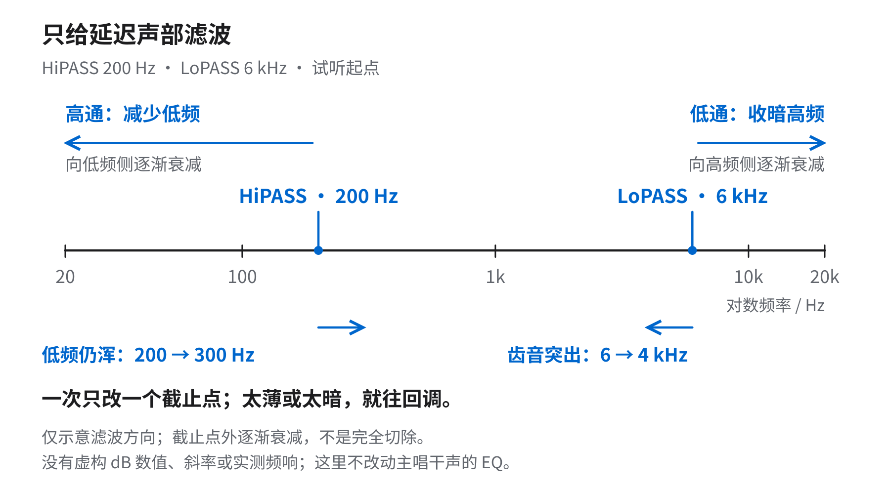

# 低 Wet 人声 Ping Pong Delay 研究报告

**研究对象：Waves H-Delay 的低 Wet 插入式人声延迟。** 本报告根据保存下来的内容稿、来源记录、计算数据、解释图与最终页面，事后重建这套八页教程的研究依据与编排理由。原资料核验日期为 2026 年 10 月 9 日；本报告整理于 2026 年 10 月 10 日。它不是当时同步撰写的研究记录，也不代表新增的音频测试。

这套内容要解决的问题很窄：主唱已经足够清楚，希望补一点左右运动与句尾空间时，怎样把延迟时间、后续重复、干湿混合和滤波分开判断。结论不是一组适用于所有歌曲的预设，而是一条可复核的试听路径：先确认路由与控件，再理解时间和反馈，最后带着伴奏比较，已经合适就停止增加。

## 一 目标与证据边界

目标读者已经会在轨道上插入插件，但可能把“延迟太明显”“重复拖太久”“重复挤住歌词”统称为效果过多。教程的教学价值在于把这三种听感拆开，让每个操作对应一个较明确的问题。

这里使用四类证据。产品功能以 [Waves H-Delay 官方手册](https://www.waves.com/1lib/pdf/plugins/h-delay-hybrid-delay.pdf) 为主，例如组件的输入输出配置、HOST 同步、PING PONG、反馈与滤波控件。数字关系来自在明确条件下的独立计算，例如 160 BPM 的普通八分音符为 187.5 ms。路由与时间图是功能或数学示意，不是反向推测出的插件内部电路。FEEDBACK 20、DRY/WET 5、200 Hz 与 6 kHz 则是自拟的试听起点，不是厂商预设或测得的最优值。

没有用于本研究的工程音频，因此不能回答某位歌手、某段歌词或某种编曲采用这些设置后实际改善多少。教程没有测得宽度、相关度、LUFS 或主观清晰度的前后差异。可核实的是控件功能、数学关系和操作顺序；最终声音仍须在具体歌曲中判断。

## 二 为什么先识别真实界面

**图 1　真实对象与控件定位。** 图中的 Waves 官方界面用于识别 DELAY、FEEDBACK、DRY/WET 和 HiPASS／LoPASS；编号位于界面外。原图呈 DUAL／BPM 状态，显示 120 BPM，左右时值分别为 1/8D 与 1/2，不能把它读作教程的 Ping Pong／HOST／普通 1/8 设置。图片版权属于 Waves，公开转载授权尚未核实。

从真实界面开始，有助于把抽象名词与可操作的对象对应起来。DELAY 回答重复出现在哪里；FEEDBACK 回答后续重复如何延续；DRY/WET 回答干声与整个延迟声部怎样混合；滤波控件回答延迟声部占据哪些频率区域。它们之间会产生听感上的相互影响，但不应因此混为同一个控制。

界面证据也限定了教程能说什么。原图没有提供可确认的插件版本号，文件日期也不能替代软件版本；界面的选中状态不能为了配合正文而重画。真实截图与建议参数分开呈现，使读者既能找到按钮，又不会误把厂商示例当作已经设置好的教程工程。[官方产品页](https://www.waves.com/plugins/h-delay-hybrid-delay) 与手册承担对象和功能证明，而不是替试听结论背书。

## 三 路由决定 Dry/Wet 的使用方式

**图 2　插入式功能路由。** 干声分支与 Delay 分支都在 H-Delay 的边界内，之后通过 Dry/Wet 混合；Feedback 回路只从 Delay 支路取回一部分信号。图不声明内部滤波、非线性、反馈取样点的精确 DSP 顺序。

教程选择低 Wet 插入，是为了让读者在同一个处理器里比较少量延迟的存在感。单声道人声需要左右输出时使用 M>S，立体声轨使用 Stereo；单声道输入本身不等于只能得到单声道效果。这个选择来自手册对组件输入输出的定义。

**图 3　发送方式的对照。** 原人声保留通往混音的干声路径，效果轨 Dry/Wet 设为 100，只返回处理后的信号；多少效果由发送量或返回推子控制。它是另一种常规路由，不应与图 2 拼成一条额外的 DAW 干声旁路。

两幅图放在一起，是为了回答“为什么有时教程说低 Wet，有时却说 100% Wet”。它们分别适用于不同的混合位置。在常规并行效果链中，若返回轨又带有干声，会额外叠加原始信号；在插入链中，插件内部则需要负责干湿混合。手册第 5–6、11 页支持这一区分。

DRY/WET 5 在本报告中始终是 H-Delay 的显示读数。没有确定其混合增益曲线与相关信号条件时，不把它写成“延迟响度是干声的 5%”，也不假设任何其他插件的 5 都具有同一电平意义。[Ableton 的 Delay 文档](https://www.ableton.com/en/manual/live-audio-effect-reference/#delay) 只用于交叉说明混合方式存在差异，不将其他产品的实现移植到 H-Delay。

## 四 从音符到毫秒的完整计算

**图 4　固定速度下的普通音符时长。** 四条线共用同一毫秒尺度，线长只表示持续时间；蓝色与灰色区分音符种类，不表示响度。

BPM 指每分钟的拍数。本例明确四分音符为一拍，固定速度下每拍时长是 60,000 ÷ BPM 毫秒。因此普通八分音符为 30,000 ÷ BPM，普通十六分音符为 15,000 ÷ BPM。

| 速度 | 四分音符 | 普通八分音符 | 普通十六分音符 |
|---|---:|---:|---:|
| 120 BPM | 60,000 ÷ 120 = 500 ms | 500 ÷ 2 = 250 ms | 500 ÷ 4 = 125 ms |
| 160 BPM | 60,000 ÷ 160 = 375 ms | 375 ÷ 2 = 187.5 ms | 375 ÷ 4 = 93.75 ms |

从 120 到 160 BPM，速度增幅为 (160 − 120) ÷ 120 = 33.33%；同一音符的时长则变为 120 ÷ 160 = 0.75 倍，即缩短 25%。这两个百分比的分母和对象不同，不能互换。HOST 同步能让插件跟随工程速度，但不能保证重复自动避开歌词；歌词密度与句尾空隙仍要听。

**图 5　一个 D 后缀改变的是实际时间。** 在 160 BPM 下，普通 1/8 为 187.5 ms，附点 1/8D 为 187.5 × 1.5 = 281.25 ms。两者相差 93.75 ms，即一个普通十六分音符。

把普通与附点时值单独解释，是因为手册列出的默认时值为 1/8D；加载不同预设后也不能假定仍是普通八分。原始截图中的 120 BPM／1/8D／1/2 仅帮助辨认字符，不是图 4 或图 5 的现场参数。BPM 的基础定义可参照 [Ableton Learning Music](https://learningmusic.ableton.com/make-beats/beat-and-tempo.html)，毫秒值由上式独立计算。

## 五 Ping Pong 交替的是延迟声部

**图 6　单次短输入后的理想左右事件序列。** 假设从左侧开始、每次间隔相同，干声记在 0 ms；圆点的大小不表示振幅。左右起点可互换，干声这一行也不代表强制居中声像。

令一次延迟间隔 T = 187.5 ms，第 n 次重复的时刻就是 nT。于是第 1 次在 187.5 ms 的左侧，第 2 次在 375 ms 的右侧，第 3 次在 562.5 ms 的左侧，第 4 次在 750 ms 的右侧。相邻重复相差 T，而同一侧前后两次相差 2T = 375 ms。

这个区分解释了为什么“每一下的节奏”与“左侧再次出现的节奏”可以不同。图没有绘制虚构波形，也没有将中心干声来回平移；在原轨声像和其他处理不变的前提下，左右运动由延迟声部提供。

H-Delay 手册要求使用具有立体声输出的相应组件、启用 PING PONG，并使 Feedback 显示值大于 1。这个“大于 1”是产品读数条件，绝不是下面数学模型里的反馈比例 g 大于 1。若需要辨认运动，可暂时适度提高 Dry/Wet，然后恢复低 Wet；不应为了听见左右交替而盲目增加反馈。

## 六 Feedback 与混合量为何必须分开

**图 7　理想线性反馈计算。** 首次重复归一化为 100，后续每次回送固定振幅比例；两组使用同一幅度尺度。这里的 g = 0.3 与 0.6 不是 H-Delay FEEDBACK 30 与 60 的测试结果。

若第 1 次重复的振幅为 A₁ = 100，每次反馈乘以 g，那么 Aₙ = 100 × g^(n−1)。在 g = 0.3 时，第 2 次是 100 × 0.3 = 30，第 3 次是 30 × 0.3 = 9，第 4 次是 9 × 0.3 = 2.7。在 g = 0.6 时，相应序列为 100、60、36、21.6。

第 4 次重复的振幅比为 21.6 ÷ 2.7 = 8。若仅把这个数学振幅比换算为电平差，20 log₁₀(8) ≈ 18.06 dB；它依然不是“听起来响 8 倍”，也不是总效果声部的响度差。两组第 1 次重复被刻意设成相同，正是为了突出后续延续可以相差很大。

还可按同一模型观察衰减时间。降到首个重复的 1% 以下，对 g = 0.3 需要 n − 1 ≥ ln(0.01) ÷ ln(0.3) ≈ 3.825，所以第 5 次为 0.81；对 g = 0.6 需要 n − 1 ≥ 9.015，所以第 11 次才降到约 0.605。在 T = 187.5 ms 时，从首个重复算起分别经过 4T = 750 ms 与 10T = 1,875 ms。这个补充推导只帮助理解“反馈决定延续”，不是插件的 RT60、尾长测量或音乐中的可听阈值。

实际处理包含滤波、饱和、调制等因素，而且人声会持续输入，并非只有一次脉冲。因此教程采用更稳妥的诊断：整个延迟声部都太明显，先减 Dry/Wet；第一下合适而后面拖太久，先减 Feedback。关于反馈与交叉反馈的一般定义，可参照 [FabFilter Timeless 3 文档](https://www.fabfilter.com/help/timeless/using/delaycontrols)，具体 H-Delay 操作仍以 Waves 手册为准。

## 七 滤波图只承诺方向

**图 8　延迟声部的滤波方向。** HiPASS 200 Hz、LoPASS 6 kHz 是试听起点；箭头表示受影响的一侧及试调方向。图没有 dB 纵轴，没有模拟出未经测量的斜率或砖墙响应。

频率从 20 Hz 到 20 kHz 跨越三个十倍区间。对数标尺上的相对位置可写为 p = log₁₀(f ÷ 20) ÷ log₁₀(20,000 ÷ 20)。200 Hz 对应 p = 1 ÷ 3，6,000 Hz 对应 p = log₁₀(300) ÷ 3 ≈ 0.8257。采用这一位置关系，能避免把 200 Hz 与 6 kHz 在横轴上随意等距摆放所造成的误读。

高通减少延迟中的低频，低通收暗重复中的高频。低频仍显浑时，可从 200 向 300 Hz 试听；齿音反复突出时，可从 6 向 4 kHz 试听。每次只改一个截止点，听到过薄或过暗就退回。这些频率不是官方建议的标准组合，也不表示截止点外声音瞬间消失。[Waves 人声 Delay 教学](https://www.waves.com/delay-tips-for-mixing-vocals) 支持按歌词密度、重复累积与音色进行判断；其产品细节若与手册冲突，本套内容采用手册说明。

## 八 八页故事怎样逐步建立判断

| 页码 | 读者需要解决的问题 | 主体证据与编排理由 |
|---|---|---|
| 01 | 看的是哪一个插件，控制在哪里 | 完整真实界面建立对象感；外部标记只做定位，紧邻说明截图不是推荐设置 |
| 02 | 低 Wet 为什么适合这里，100% Wet 又用于哪里 | 主图展开插入的内部干湿支路，发送作为对照；先澄清信号流，避免后面参数解释失去对象 |
| 03 | 同样写 1/8，为什么不同歌感觉不同 | 共用毫秒轴比较两种速度和两种时值；附点提醒解决容易忽视的 D 后缀 |
| 04 | 左右到底如何交替 | 将时间计算转成 L／R 事件轴；强调相邻与同侧间隔，另列产品启用条件 |
| 05 | 第一声不大，为什么尾巴仍然拥挤 | 两组反馈模型保持相同首个重复与相同尺度；引导把反馈和混合量分别调 |
| 06 | 怎么让延迟不抢干声的频率位置 | 真实滤波控件配对数频率标尺；只画方向，避免假造频响 |
| 07 | 能从哪一组数开始比较 | 用独立参数表与顺序试听，不往官方截图上粘贴新值；明确起点并非预设 |
| 08 | 怎么判断够不够，哪里出了问题 | 问题映射到控制项，再回到伴奏、响度匹配和单声道检查；结尾设定音乐上的停止条件 |

全套以白与浅灰背景、深色正文、克制蓝色区分重点，图形围绕当前问题变化：对象图、信号流、时间轴、振幅对照、频率标尺、试听清单各司其职。这样安排的目的在于让视觉形式服务解释，避免每页都压成同一种卡片，也避免用夸张装饰代替条件与限制。

**图 9　最终页面总览。** 总览用于观察叙事顺序，不作为小字阅读或音频效果证明。独立解释图比总览更适合核对公式、轴与条件。

## 九 一次可复现的试听

建议先挑一段同时有密集咬字和句尾空隙的短循环，并带伴奏比较。H-Delay 使用 M>S 或 Stereo，PING PONG 开启，HOST 选择普通 1/8；FEEDBACK 从 20、DRY/WET 从 5、HiPASS 从 200 Hz、LoPASS 从 6 kHz 起步。ANALOG 设为 OFF，LoFi 关闭，MODULATION DEPTH 为 0，ØL／ØR 关闭，是为了减少这次对照中的额外变量，不是对这些功能好坏的评价。

先固定其他参数，比较 DRY/WET 0、3、5、8；选定混合量后比较普通 1/8 与 1/16；再根据延续调整 Feedback。最后才一次改一个滤波截止点。数字按插件读数记录，0／3／5／8 是候选设置，不是等响度或等比例阶梯。

改变延迟时间可能产生过渡音高变化。要比较稳定状态，可停播后改值，再从同一位置重新开始，避免将变参时的过渡音误判成最终音色。短时值会更快排完同一串理想衰减，但持续进入的人声也会重叠，所以“改成 1/16 就一定更干净”并不成立。

最终检查包括：歌词、句尾与下一句是否仍清楚；尽量匹配旁通前后的响度后是否仍偏好处理结果；将 L 与 R 按实际工具的方式合并为单声道后，音色、音量与平衡是否出现不希望的变化。单声道不是只听左声道，ØL／ØR 的极性反转也不是时间对齐或通用拓宽。检查时始终留意输出峰值，避免削波。

## 十 可公开理解的结论与剩余限制

这套教程建立的是一个可重复的判断过程。时间决定重复落点，Feedback 影响后续延续，Dry/Wet 控制混合，滤波改变延迟声部的频率占用；这些关系可以通过手册与数学说明，但不能替代整首歌的实际试听。建议参数保留可撤回、一次一项、匹配响度的特点，读者不需要为了完成教程而坚持保留处理。

图中的厂商界面有清楚来源，不等于已经取得任意平台、任意商业用途的公开转载许可。原创解释图的存在也不会自动授予其中嵌入界面的再许可权。本报告不将厂商原图、手册或页面全文声明为可自由复用素材；具体再发布用途应另行核对相应授权范围。

## 参考资料

- [Waves H-Delay 产品页](https://www.waves.com/plugins/h-delay-hybrid-delay)：对象与真实界面来源。
- [Waves H-Delay User Guide](https://www.waves.com/1lib/pdf/plugins/h-delay-hybrid-delay.pdf)：第 4–6 页的模式与路由，第 8 页的时间和默认时值，第 9–11 页的相关控件。
- [Waves 10 Delay Tips for Mixing Vocals](https://www.waves.com/delay-tips-for-mixing-vocals)：歌词密度、滤波、累积和放回伴奏的试听背景；未采用与手册不一致的独立左右控制说法。
- [FabFilter Timeless 3 Delay controls](https://www.fabfilter.com/help/timeless/using/delaycontrols)：一般反馈概念，非 H-Delay 刻度依据。
- [Ableton Live Delay](https://www.ableton.com/en/manual/live-audio-effect-reference/#delay)：通用混合方式与路由的交叉参考。
- [Ableton Beat and tempo](https://learningmusic.ableton.com/make-beats/beat-and-tempo.html)：速度定义；具体数值为本文计算。
- [Waves 4 Tips for Mixing 2021 Pop Vocals](https://www.waves.com/tips-for-mixing-2021-pop-vocals)：HOST、滤波及 Analog Off 的背景；没有将其中的 throw 示例当作本套预设。
- [iZotope Ozone Utilities](https://www.izotope.com/community/blog/how-to-use-ozone-utilities)：响度匹配与单声道检查的参考。
- [Waves Terms of Use](https://www.waves.com/legal/waves-terms-of-use)：图片权利范围核对入口；本报告不作具体法律结论。
