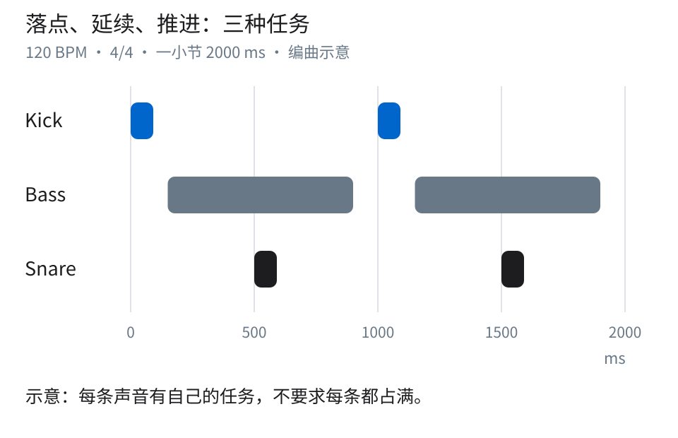
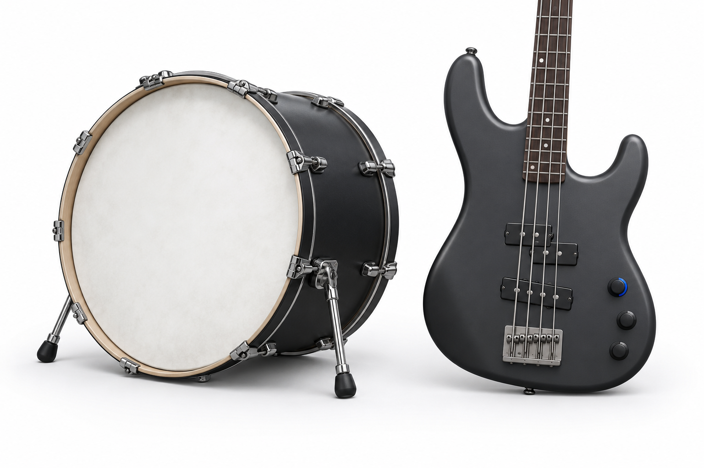
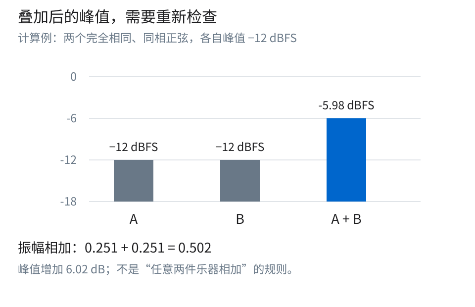
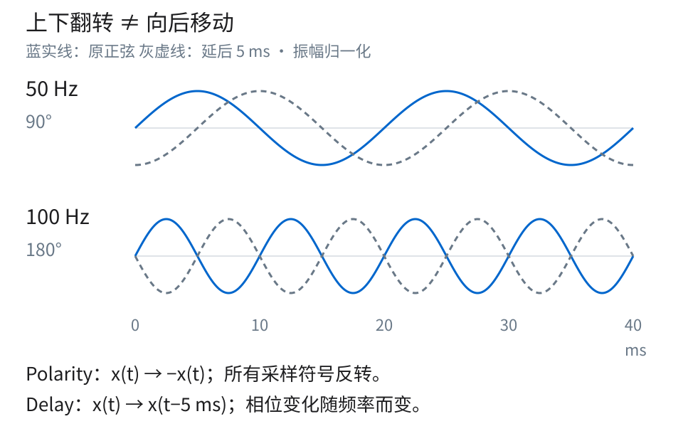
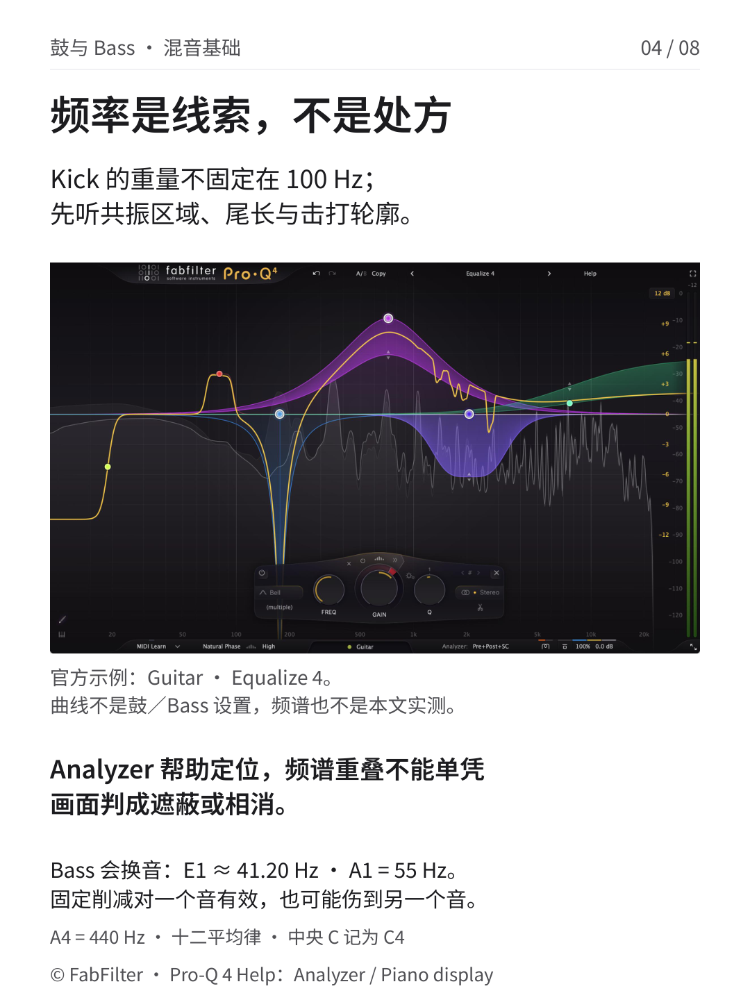
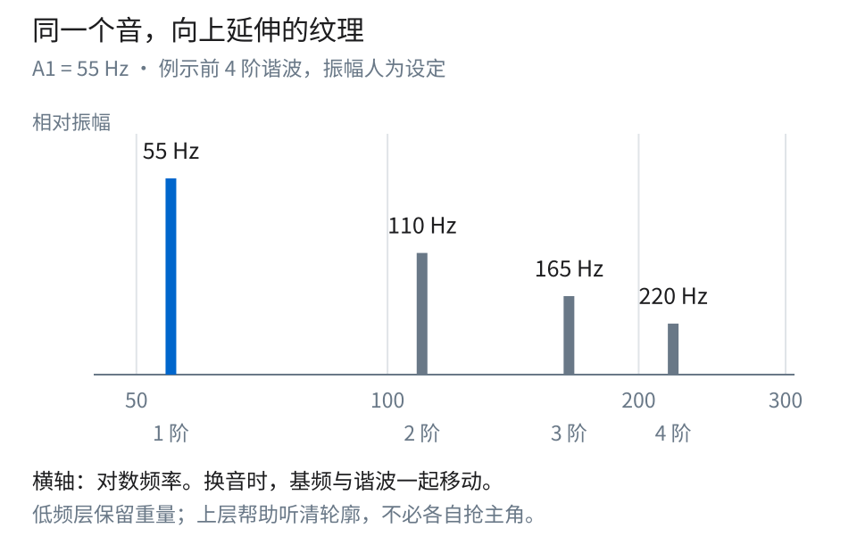
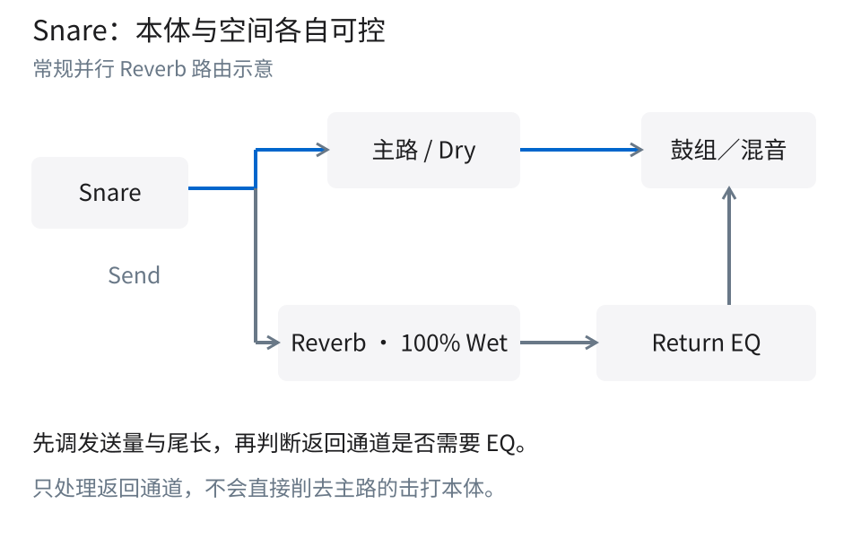

# 鼓与 Bass 的关系研究报告

**研究对象：鼓与 Bass 在音量、时间、频率与前后层次上的配合。** 本报告依据保存下来的文章、来源记录、数学数据、解释图与八页成品，事后重建制作前需要厘清的研究问题和叙事理由。原资料核验于 2026 年 10 月 9 日，本报告整理于 2026 年 10 月 10 日；它不是同期研究日志，也不包含新的工程音频测试。

本套内容的核心判断是，先建立声部关系，再决定音色处理。Kick、Bass、Snare 的落点、延续和重音如果还没有形成清楚的关系，单独把每件乐器做得更大、更亮，未必会改善整段音乐。教程因此按音量平衡、时间与极性、频率分工、前后层次的顺序展开，最后用不同段落、单声道和匹配响度的旁通比较验收。

## 一 研究目标与证据范围

目标读者已经会使用推子、EQ 与 Send，但容易把经验频点当作固定处方，或者把一次鼓点变大当作全曲改善。本报告要让读者分清四种不同问题：某个声部整体过多；两层信号的叠加关系不稳定；频率与音符角色冲突；空间或高频打击乐遮住歌曲重心。它们可能同时发生，但需要分别验证。

来源以厂商手册与厂商教育资料为主，承担具体功能、术语和通用原理的依据。例如 Ableton 文档支持混音路由与电平边界，Shure 的录音资料支持相位关系的解释，FabFilter 文档支持 Analyzer 与音符显示的功能，iZotope 文章提供编曲、包络、谐波和鼓组 EQ 的讨论背景。

数值分成两类。120 BPM 的 500 ms 一拍、两个相同正弦相加增加 6.02 dB、5 ms 在 50 Hz 与 100 Hz 下的不同相位变化，以及 E1、A1 和谐波位置，是明确假设下的计算。300 Hz、1 kHz、2–3 kHz、5–8 kHz 等则是有条件的试听搜索区，不是经过本研究测得的目标值。没有实际音频，所以不能声明低频冲突已被消除、峰值已改善或某种处理已通过听测。

## 二 把编曲角色与声波形状分开

**图 1　落点、延续与重音的概念时间轴。** 这是 120 BPM、4/4、一个小节的事件示意。Kick 与 Snare 方块宽度没有声学衰减含义，Bass 长条也是编曲区间，不是从录音测得的包络。

四分音符为一拍时，120 BPM 的每拍为 60,000 ÷ 120 = 500 ms。八分音符为 250 ms，4/4 一小节为 4 × 500 = 2,000 ms。图中 Kick 在 0 与 1,000 ms，Snare 在 500 与 1,500 ms；Bass 的两个示例区间为 150–900 ms 与 1,150–1,900 ms，各长 750 ms。

这些位置用来说明“声部不必占满同一时刻”。150 ms 的进入偏移也不是一个标准八分网格值，不应被读成所有 Bass 都要比 Kick 晚 150 ms。图没有规定 groove、音符长度或配器；改变编曲角色时，Kick 可以承担更长延续，Bass 也可以承担明确落点。

最终封面没有强行塞入这张完整时间轴，而是用概念插画与角色文字建立入口。时间图保留为扩展解释素材，适合在研究报告中把节拍数字讲完整。这个取舍避免封面同时承担“认识主题”和“读精确时间坐标”两个任务。

**图 2　封面主题图。** 这是 AI 概念插画，用于联想鼓与 Bass 的配合，不是录音场景、器材实拍、频谱或声场测量。它没有为任何参数结论提供数据证据。

## 三 先用推子建立关系再检查叠加峰值

建议先把 Kick 放在舒服且留有余量的位置，再逐渐加入 Bass，听落点与音符能否同时辨认，然后加入 Snare。这个顺序帮助减少初次平衡时的变量，但不规定 Snare 必须高于 Kick，也不存在跨曲风通用的 Kick 峰值目标。对一首歌成立的音量关系，在另一首歌中可能破坏重心。

**图 3　为什么单轨安全不等于叠加后不用检查。** 输入 A、B 都是峰值 −12 dBFS、完全相同且同相的正弦，无额外处理；输出为约 −5.98 dBFS。这是计算示例，图中的 A、B 不是两条已测量的鼓与 Bass。

把数字满刻度幅度归一化为 1，输入峰值幅度为 a = 10^(−12／20) = 0.2511886432。同相且逐样本相同的两条信号相加，峰值幅度为 2a = 0.5023772864。转换回分贝，20 log₁₀(0.5023772864) = −5.9794000867 dBFS。

峰值增量为 −5.9794 − (−12) = 6.0206 dB，也等于 20 log₁₀(2)。这不是把两个“−12”直接相加，更不是任意两件乐器相加都会固定多 6 dB。真实 Kick 与 Bass 的波形、包络、频率和瞬时相位会变化，峰值出现的时间也不一定重合。

这个模型支持的行动只有一个：叠加后重新检查相关轨道、处理器、总线和输出。它不把 −12 dBFS 推广为推荐轨道目标。[Ableton Mixing](https://www.ableton.com/en/manual/mixing/) 对内部浮点余量的说明，也不意味着物理输出或定点导出可以随意越界；反过来，某些内部总线超过 0 dBFS 也不能一概描述为已经发生不可恢复的削波。需要根据实际信号路径判断，并检查产生失真的位置。

## 四 遮蔽相消与尾长不是同一个问题

Bass 加入后 Kick 难以辨认，可能是频率、包络或注意力上的遮蔽；两者重叠时某些低频明显减少，才有理由进一步检查极性与时间关系。尾音过长则可能让前一击持续占据下一击的位置。三者都能让低频“不清楚”，但不应一律用反相按钮处理。

**图 4　上下翻转与沿时间移动。** 蓝实线是原正弦，灰虚线是延后 5 ms 的正弦；两行共用 0–40 ms 时间轴、归一化振幅。波形由公式生成，不是 Kick／Bass 录音波形。

Polarity 反转写成 x(t) → −x(t)，使每个样本改符号；Delay 写成 x(t) → x(t − τ)，把信号沿时间移动。对稳定单频正弦，延迟造成的相位滞后幅度是 Δφ = 360° × f × τ。取 τ = 0.005 s：

| 频率 | 周期 T = 1／f | 5 ms 占周期的比例 | 相位滞后幅度 |
|---|---:|---:|---:|
| 50 Hz | 20 ms | 5／20 = 1／4 | 360° × 50 × 0.005 = 90° |
| 100 Hz | 10 ms | 5／10 = 1／2 | 360° × 100 × 0.005 = 180° |

因此同一个 5 ms 对 100 Hz 单一正弦等于半周期移动，该正弦的结果与极性反转相同；对 50 Hz 却只有四分之一周期，并不等同极性反转。说“延迟 5 ms 就是反相”省略了决定结论的频率条件。

还可以在同一理想模型中计算两条等幅正弦的叠加。相位差为 φ 时，合成振幅相对单条为 2 × |cos(φ／2)|。90° 时为 √2 ≈ 1.4142，对应约 +3.0103 dB；180° 时为 0，理想抵消。这个补充推导解释了为什么同样移动时间，可能保留一个频率而抵消另一个频率。它不能预测真实鼓和 Bass 的整体音量变化，因为真实信号不是两条固定、等幅的正弦。

实践上应比较多个音符与鼓点，听整段的低频稳定性和 groove。一次极性翻转只让某一击更大，不足以证明全曲已经“相位对齐”。在移动音频前，也应考虑尾长、音色、音符安排与进入时机；不要为了重合一个可见波峰而破坏音乐起音。[Shure 录音资料](https://www.shure.com/en-US/docs/education/Microphone-Techniques-for-Recording) 与 [Ableton Utility 文档](https://www.ableton.com/en/manual/live-audio-effect-reference/#utility) 提供术语与功能背景，具体角度由本文计算。

## 五 Analyzer 提供线索不直接判定病因

**图 5　真实界面的正确证据角色。** 页面中的 FabFilter Pro-Q 4 官方截图显示轨道 Guitar、预设 Equalize 4。其曲线和频谱只用于识别产品与分析界面，不是鼓或 Bass 的推荐设置，也不是本文音频测试。FabFilter 保留图片版权，公开再发布许可范围尚未完整核实。

Kick 的重量并不固定在 100 Hz。不同音色可以具有不同的共振、尾长、击打轮廓与随时间变化的音高；只看一张频谱便把固定低频位置认作“必须保留的基音”，容易忽视这些差异。Bass 还会换音，固定频段的削减对一个音有效，对另一个音可能恰好削到重要部分。

在 A4 = 440 Hz 的十二平均律中，每个半音的频率倍率是 2^(1／12)。A1 比 A4 低三个八度，所以 A1 = 440 ÷ 2³ = 55 Hz。E1 比 A4 低 41 个半音，频率为 440 × 2^(−41／12) ≈ 41.20344461 Hz，约 41.20 Hz。本文采用中央 C 记为 C4 的八度标注；某些 DAW 的八度数字不同，不会改变同一声音的实际频率。

这两个低音相差约 13.80 Hz，但对音乐判断更重要的是，它们在调性中的音高角色不同、谐波位置也一起移动。频率图能协助找到能量所在，却不能单凭“两个峰重叠”证明遮蔽，更不能直接证明相消。[Pro-Q 4 Analyzer 文档](https://www.fabfilter.com/help/pro-q/using/analyzer) 说明了 Pre／Post／外部频谱及相关显示选项；分析分辨率与 tilt 等设置也会改变画面的样子。

若 Kick 在 800 Hz–2 kHz 听起来显硬，可以把约 −1 至 −2 dB 的宽 Bell 当作一个小幅试验，尽量匹配响度后旁通比较。不显硬就没有必要因为读到了这段频率而削减。最终页面将这条细节留在完整文章中，把主要空间留给“频率是线索”的判断，以免它喧宾夺主变成参数处方。

## 六 Bass 的重量与可辨认轮廓

**图 6　谐波位置与人为示意幅度。** 横轴为对数频率，55、110、165、220 Hz 分别为第 1–4 阶；高度 1、0.62、0.40、0.26 是人为设定的相对振幅。它们不是某个 Bass 的实测频谱，不表示哪种振幅配比最合适。

谐波频率的基本关系是 fₙ = n × f₀。A1 的基频 f₀ = 55 Hz，所以第 2、3、4 阶分别是 2 × 55 = 110 Hz、3 × 55 = 165 Hz、4 × 55 = 220 Hz。若改为 E1，前四阶随之变为约 41.20、82.41、123.61、164.81 Hz。图中的竖线不是一组固定 EQ 中心点，换音后整组位置都会变化。

对数轴上频率翻倍具有相同距离，所以 55→110 与 110→220 间距相同；110→165 的倍率只有 1.5，对数间距更短。这个细节让图真正解释频率比例，而不是把“四阶谐波”任意排成等距装饰柱。[FabFilter One 的 Filter 文档](https://prod.fabfilter.com/help/one/using/filter) 支持谐波为基频倍数的概念，具体频率与示意振幅由本报告明确区分。

在低频重放受限的设备上，已有的谐波成分可能帮助保留 Bass 的音高与轮廓。这不保证所有小音箱都能重放图示的 55–220 Hz，也不保证只要加高次谐波就更好。[iZotope 的低频处理讨论](https://shopify.izotope.com/community/blog/mastering-low-end) 提供这一思路的背景，实际需要换到目标小音箱检查。

原教程另提到可在 800 Hz–2.5 kHz 搜索音符轮廓，但这一区间并不是图中前四阶谐波的直接延伸图示。以 55 Hz 为基频，800 ÷ 55 ≈ 14.55、2,500 ÷ 55 ≈ 45.45，已经涉及更高阶区域和具体音色结构。两条说明服务不同层次：低阶谐波图解释倍频关系，较高频的搜索建议帮助判断实际素材中的可辨认细节；两者都不是必须提升某段频率的指令。

如果另有高频 Bass 层，先比较音乐起音、时值和音高，再从小电平加入，判断它能否作为同一声部的纹理。刻意做成独立节奏或不同音符当然可以是编曲选择；本套建议只针对希望两层听起来属于同一 Bass 的情形。完成后同时回到全频监听，防止小音箱上的轮廓改善伴随原低频质感变差。

## 七 Snare 本体与空间分开管理

**图 7　常规并行 Snare Reverb。** 主路保留鼓本体，Send 进入 100% Wet 混响，返回可以单独调节电平与 EQ。图不指定发送取点，也不声明任何电平值；Return EQ 不直接处理主路的原始击打。

Snare 的厚度、击打感与空间尾声承担不同任务。约 300 Hz 可以作为厚度的搜索起点；约 1 kHz 若听到硬度或突出共振，再考虑局部处理。它们都取决于音色、调音和编曲，不是每个 Snare 必须进行的提升或削减。

空间过于抢耳时，先减少 Send 或缩短尾声，再判断返回的 2–3 kHz 是否拥挤。这样做是先处理空间量和持续时间，再处理音色，避免只靠 EQ 掩盖过量混响。常规辅助混响设为 100% Wet 的依据可参考 [FabFilter Reverb 教学](https://www.fabfilter.com/learn/reverb/how-to-use-reverb)。是否使用混响本身仍是歌曲选择。

削弱击打区后提升 10 kHz，只会改变另一个频段的亮度，不能等价恢复先前损失的击打清晰度。这里的重点是认识不同频段并非可随意兑换的“亮度额度”。若处理后只剩明亮边缘而失去本体，就应重新检查原先的削减或空间量，而不是继续往更高处提升。

## 八 高频打击乐的处理方式跟随问题发生的时间

**图 8　定性判断顺序。** 四个节点依次是整体音量、刺耳的时刻与频段、静态／动态处理选择、回到合奏。线条不编码电平大小，不规定 Hi-hat 或 Cymbal 相对人声的固定数值。

如果高频打击乐整段都太突出，先试推子。若只是少数重击刺耳，可以考虑动态 EQ，使处理与问题出现的时刻更相关；若整段都过亮，静态 EQ 可能更直接。5–8 kHz 只是一个可能的搜索区，并不是看到镲片就必须削掉的频带。动态处理也不是天然更好，仍须听它是否削弱了应该保留的重击与节奏表现。

大打击乐需要的体积，不等于可以无限加低频。1–3 kHz 的硬度、尾长、进入时机，以及它和人声、Snare 的关系，都会影响高潮的力度。反过来，过度高通可能削掉身体感，只留下尖锐边缘。[iZotope How to EQ Drums](https://www.izotope.com/community/blog/how-to-eq-drums) 提供按音色与编曲判断的背景；本套内容没有把其中某个经验动作升级成强制处方。

## 九 八页内容的教学顺序

| 页码 | 需要建立的判断 | 图像或解释方式及其限制 |
|---|---|---|
| 01 | 先听声部关系，再处理各自音色 | AI 概念图配 Kick／Bass／Snare 角色文字；不规定固定音量排序，完整时间轴作为补充材料 |
| 02 | 推子与余量先过关 | 相同正弦的峰值相加图解释为什么要查总线；−12 dBFS 只是模型输入 |
| 03 | 极性反转与时间移动不同 | 共用时间轴上的 50／100 Hz 正弦，让相位变化随频率改变这一点可见；不冒充录音波形 |
| 04 | 频率图帮助定位，不能单独诊断 | 真实 Pro-Q 4 界面与 E1／A1 计算；明确 Guitar／Equalize 4 是官方示例状态 |
| 05 | 低频重量之外还有谐波轮廓 | 用真实频率位置和明确人为振幅的谐波图，再连接到实际小音箱验证 |
| 06 | Snare 本体与空间应有独立控制 | 用并行路由表示主路与返回，先量和尾长、后频率；没有要求所有 Snare 加混响 |
| 07 | 高频问题是持续还是偶发 | 用定性判断路径选择推子、静态或动态处理；频率范围仍是搜索假设 |
| 08 | 整段稳定比单击更大重要 | 低音量、Mono、换段落、匹配响度四次复核；不以单个数值或截图宣布成功 |

这套顺序把最容易撤回、最少改变声音结构的比较放在前面，再逐渐进入时间、频率与空间。数学只用于揭示容易误解的关系，不充当声音好坏的评分。版面相应采用关系文字、定量图、波形示意、真实对象图和路由图交替，避免在每页堆积一整张“频率处方表”。

**图 9　最终页面总览。** 总览展示从关系到验证的节奏；图中的官方产品截图仍是功能说明，其他波形与数字仍是计算或概念示意。研究结论不依赖把这些页面误认为实际 DAW 工程记录。

## 十 一段音乐如何验收

**图 10　听音检查而非测试成绩。** 四个节点是建议执行的检查，没有附带伪造的宽度、响度或清晰度改善指标。

先在较低监听音量下确认 Kick 落点、Bass 音符和 Snare 重音能否跟住。然后把左右合并成 Mono，听低频与多层 Bass 是否异常变薄；这一步不是只听左声道，也不能取代 Stereo 中的整体平衡判断。

再换主歌、副歌、不同音符与不同强度的鼓点。固定 EQ、时间移动或极性选择若只服务了单个音符，应在这里暴露局限。最后尽量匹配处理前后的听感响度进行旁通比较，确认偏好来自关系更清楚，而不是仅仅更响；并检查每个相关处理阶段与输出的余量。

验收的停止条件是，已听到的问题得到改善，同时没有破坏 groove、音色本体、其他段落或空间层次。没有问题的频段不必照表处理，没有持续收益的改动应撤回。侧链、动态避让或更深入的包络处理可以是其他工具，但不需要为了完成这套教程而全部加入。

## 十一 可复核结论与尚不能证明的部分

可复核的部分包括：120 BPM 一拍 500 ms 的时间关系；相同同相正弦的 6.0206 dB 峰值增量；5 ms 在不同频率下产生不同相位变化；A4 = 440 Hz 的音符频率与整数倍谐波；主路与全 Wet 返回的功能区别。每一项都附有条件，离开条件就不能照搬数值。

不能由这些图证明的部分包括：任意两件乐器会增加多少峰值；某一极性选择适用于整首歌；固定 100 Hz 一定是 Kick 的重量；某个频谱重叠就是遮蔽；任意小音箱一定能够重放某阶谐波；某段 EQ 必然改善清晰度。这些都是需要具体素材与听音环境的经验问题。

此外，FabFilter 官方 press kit 表明图像来源可核对，但不是任意再发布用途的完整开放许可。本报告保留原始示例状态和版权说明，不把截图或厂商全文声明为可自由复用素材。原创概念图与解释图也不改变其中第三方素材的权利范围。

## 参考资料

- [Ableton Live 12 Mixing](https://www.ableton.com/en/manual/mixing/)：电平、混音与内部余量的边界。
- [Shure Microphone Techniques for Recording](https://www.shure.com/en-US/docs/education/Microphone-Techniques-for-Recording)：相位关系与信号叠加的概念背景。
- [FabFilter Pro-Q 4 Spectrum analyzer](https://www.fabfilter.com/help/pro-q/using/analyzer)：频谱显示与潜在冲突提示的功能范围。
- [FabFilter Pro-Q 4 Piano display](https://www.fabfilter.com/help/pro-q/using/pianodisplay)：音符与频率的界面关系。
- [FabFilter One Filter](https://prod.fabfilter.com/help/one/using/filter)：谐波与基频的关系。
- [iZotope How to Mix Kick and Bass](https://shopify.izotope.com/community/blog/how-to-mix-kick-and-bass)：编曲、音色、包络与有条件避让的背景；未采用固定主次或普遍成功率断言。
- [iZotope Mastering low end](https://shopify.izotope.com/community/blog/mastering-low-end)：谐波支持低频辨认的讨论。
- [iZotope How to EQ Drums](https://www.izotope.com/community/blog/how-to-eq-drums)：Snare、打击乐与镲片的条件化 EQ 思路。
- [FabFilter Press Area](https://www.fabfilter.com/press)：官方产品截图来源。
- [Ableton Utility](https://www.ableton.com/en/manual/live-audio-effect-reference/#utility)：左右极性反转相关功能。
- [FabFilter How to use reverb](https://www.fabfilter.com/learn/reverb/how-to-use-reverb)：常规辅助混响的 100% Wet 与发送量控制。
