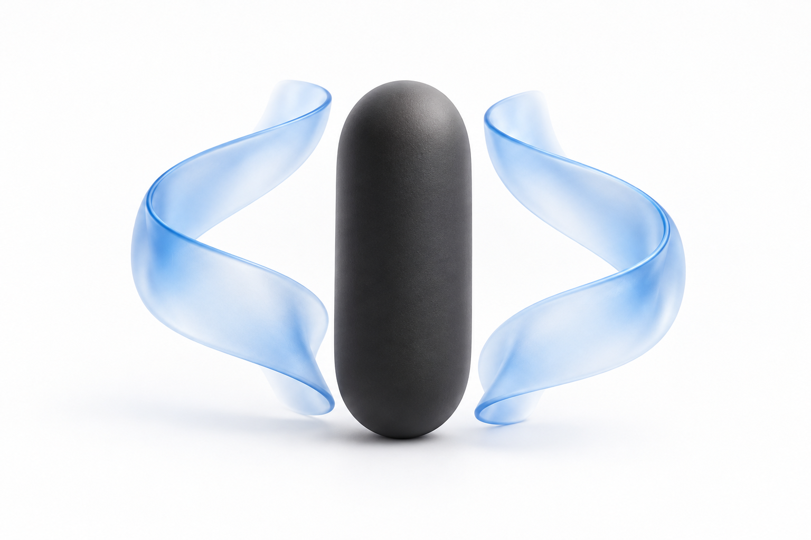
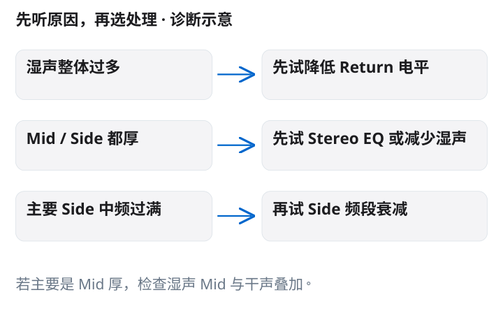
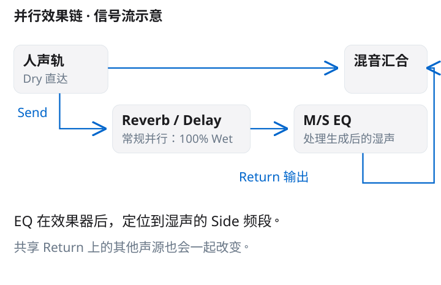
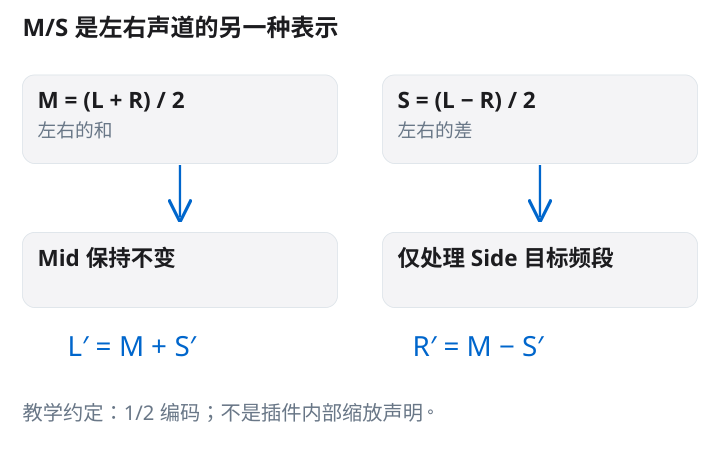
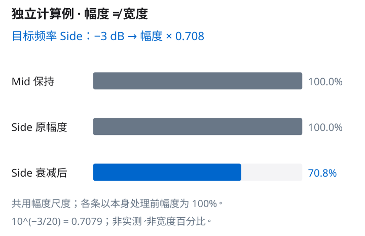
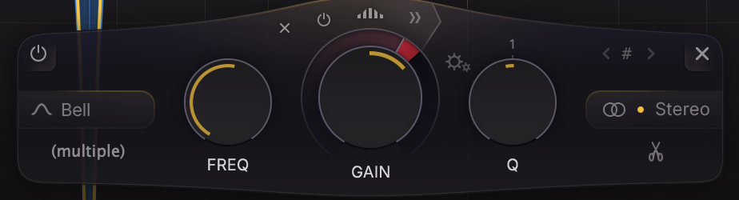
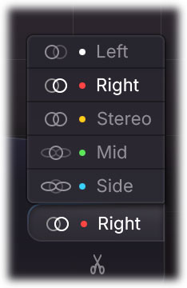
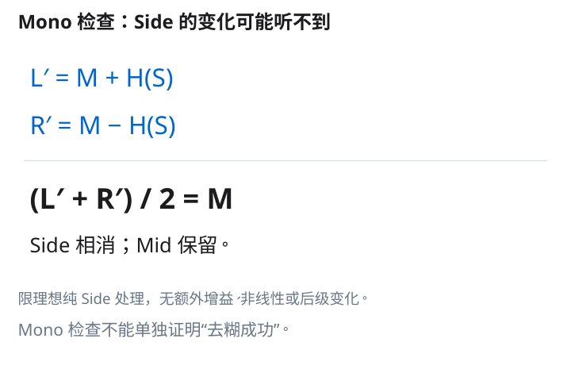

# 人声效果返回的 M/S EQ 研究报告

**研究对象：立体声 Reverb／Delay 返回上的局部 Side EQ。** 本报告根据保存的文章、事实与来源记录、计算数据、解释图和七页成品，事后重建教学内容在制作前需要解决的研究问题与叙事依据。原资料核验于 2026 年 10 月 9 日，本报告整理于 2026 年 10 月 10 日；它不是同期研究日志，也没有追加音频实测。

核心结论是先判断问题是否来自湿声，再区分湿声总量、频率平衡和左右差分。只有多余中频主要落在 Side 时，局部 Side 衰减才是值得比较的选项。M/S 不是一种必需的“高级去糊技术”，也不是从混音中提取两侧乐器的方法。七页教程把这一有条件的处理放在诊断之后，并以 Stereo、Mono 和不同段落的复核结束。

## 一 为什么从返回电平开始

**图 1　问题的概念表达。** 中央主体和两侧蓝色形态用来联想人声与空间；这是 AI 概念插画，不是声场测量、声道能量分布或设备实拍。它只承担入口的视觉比喻，不能证明 Side 过多。

人声加上空间效果后变厚，不足以说明干声的中频需要处理，也不足以说明宽度过大。如果静音返回后臃肿感减轻，湿声可能参与了问题，但这仍是一个诊断线索。返回电平、混响尾长、延迟重复以及湿声与干声的频率叠加，都可能造成相似的听感。

因此第一步是静音／恢复 Return，并小幅降低返回电平。若已经得到所需的清晰度，就没有必要继续加入 M/S EQ。这个顺序既减少变量，也避免把简单的量感问题变成复杂的声道处理。它是本文提出的试听策略，不是厂商保证有效的排障规则。

**图 2　条件化的诊断图。** 第一行先处理湿声总量；后两行分别考虑整个湿声的频率平衡与 Side 中频过满。图下的补充说明提醒：若主要是 Mid 偏厚，应检查湿声 Mid 与干声的叠加。箭头表示下一步可试什么，不表示已经确定病因。

Mid／Side 辅助监听只帮助定位。单独听某个差分频段时不悦耳，不代表它在合奏中一定有害；失去其他声部之后，很多声音的意义会改变。尤其要区分 Pro-Q 的 Band Solo 与全频 Mid／Side Solo：厂商的 [Solo 文档](https://www.fabfilter.com/help/pro-q/using/solo) 说明的是频段定位工具，不能把它当成一键听完整 Side 或直接证明处理后效果的工具。

## 二 什么由来源支持 什么由计算和试听提出

这份研究将证据分成三层。第一层是产品与路由事实：[Pro-Q 4 Stereo options](https://www.fabfilter.com/help/pro-q/using/stereo) 支持每个频段选择 Stereo、Left、Right、Mid 或 Side，也说明 Mono 实例的限制；[Band controls](https://www.fabfilter.com/help/pro-q/using/bandcontrols) 支持 Bell、频率、增益、Q 与 stereo placement 的操作位置；[Ableton Mixing](https://www.ableton.com/en/live-manual/12/mixing/) 说明 Send 与共享 Return 的关系。

第二层是数学定义和推导。本文采用 M = (L + R)／2、S = (L − R)／2，并以 L = M + S、R = M − S 解码。这个归一化约定可逆且便于教学，不声称就是 Pro-Q 内部使用的缩放。−3 dB 对应约 0.708 倍幅度、理想 Side 处理不改平均 Mono，都是由定义推导的结果。

第三层是诊断与试听建议，例如先降 Return、仅在 Side 中频过满时试 Side EQ，以及 Side Bell 400 Hz、−2 dB、Q 1.0 的搜索起点。这些不是官方推荐或实测最佳设置。没有工程音频，所以本文不提供清晰度、宽度或响度改善比例。

## 三 EQ 为什么放在效果器之后

**图 3　常规并行效果链。** 干声直接进入混音；Send 进入 100% Wet 的 Reverb／Delay，随后由 M/S EQ 处理已经生成的湿声，再通过 Return 汇入混音。蓝色支路表示所讨论的效果路径，不表示它必须比干声更响。

这个研究对象是“返回中已经形成的立体声差分”。把 EQ 放在效果器之后，能够对这一对象进行处理。放在效果器之前，则改变送入效果器的信号；当效果器会生成立体声差异、调制或非线性时，前置处理与后置处理不保证等价。教程不需要假设每个效果器的内部结构，只需准确说明两种位置所处理的对象不同。

常规辅助效果链采用 100% Wet，使原人声由主路保留，返回负责效果。这个做法可在 [Ableton 的音频效果参考](https://www.ableton.com/en/live-manual/12/live-audio-effect-reference/) 中相关 Reverb／Echo 章节找到依据，但不意味着所有创意路由都必须如此。

共享返回还带来范围问题。若和声、军鼓与主唱同时进入该返回，Side EQ 会处理它们合成后的湿声，而不是只认识主唱。需要只改人声时，独立返回更容易控制；保留共享返回时，验收就必须听其他声源。图中不指定 pre-fader／post-fader 发送方式，不能据图推断推子与发送量的联动。

## 四 M/S 是表示法 不是声部分离

**图 4　固定归一化的 M/S 矩阵。** 两个分支分别表示和与差；Mid 保持，Side 的目标频段被处理，之后重新解码成左右。图中的 M、S 是信号，不是两组固定乐器。

从 L、R 出发，编码为：

- M = (L + R)／2
- S = (L − R)／2

代回即可验证 L = M + S = [(L + R) + (L − R)]／2；R = M − S = [(L + R) − (L − R)]／2。因而它是可逆的和差表示，不会因为换了一种表示就知道哪些声音是人声、哪些乐器位于两边。[Voxengo MSED](https://www.voxengo.com/product/msed/) 提供 M/S 编解码与独立控制的产品参考，以上系数是本报告自行明确的教学约定。

三个极端例子有助于消除误解。若 L = R = x，则 M = x、S = 0，纯 Side 处理对这个信号没有可处理的差分。若 L = x、R = −x，则 M = 0、S = x，衰减 Side 会衰减这整个反相关信号。若只有左声道有 x，L = x、R = 0，则 M = x／2、S = x／2：即使声音原先完全在左边，也同时出现在 Mid 与 Side 表示里。

最后一个例子尤其说明“Mid 只有中间的主唱，Side 只有两侧的乐器”不成立。实际声源的声像、立体声效果、相位关系和相关程度共同决定它在 M/S 中的分布。Side EQ 减少目标频段的差分，可让该频段的空间听感更收拢，但不会按乐器身份自动分离处理。

## 五 把分贝换成幅度而不是宽度

**图 5　独立的 −3 dB 幅度计算。** 每条以自身处理前的幅度为 100%；Side 处理后为约 70.8%。这种归一化不表示原始 Mid 与 Side 在真实音频中本来一样大，也不表示宽度变成 70.8%。

幅度增益与分贝的关系是 g = 10^(G／20)。当 G = −3 dB，g = 10^(−3／20) = 0.7079457844，因此 100 个相对幅度单位变为 70.7946，四舍五入为 70.8。幅度减少约 29.2%，但不能把它改写成主观响度下降 29.2%。若讨论同一信号、相同负载条件下的平方幅度比，则 g² ≈ 0.5012；这个约 50.1% 的量又是另一个对象，仍不是宽度。

为展示矩阵如何影响左右，用一个只考察实数增益、忽略相位旋转的窄带数学例子。处理前令 L = 0.8、R = 0.4，则 M = (0.8 + 0.4)／2 = 0.6，S = (0.8 − 0.4)／2 = 0.2。将该频率的 Side 乘以 −3 dB 对应的 g，得到 S′ = 0.2 × 0.7079457844 = 0.1415891569。

重新解码后，L′ = 0.7415891569，R′ = 0.4584108431。左右差从 0.4 变为约 0.2831783138，正好是原来的 70.7946%；左右平均仍为 0.6。这个数例表明减少差分可能同时降低较强一侧、提高较弱一侧的这一实数分量，不能简单理解为把左右两条声道都等量拉低。真实 EQ 在频率之间的增益和相位行为更复杂，本例只验证和差运算，并非对某个 Bell 的完整响应预测。

试听设置中的 −2 dB 与这个 −3 dB 计算例必须分开。−2 dB 对应 g = 10^(−2／20) ≈ 0.794328，即目标处约 79.4% 幅度。选择 −2 dB 是从较小处理开始的建议；选择 −3 dB 做图是为了清楚展示 dB 与幅度的换算。两者没有构成“处理前后测得差一分贝”的实验。

## 六 真实菜单如何用于教学

**图 6　频段控制区。** 这是 FabFilter 官方界面的局部裁切，用于定位 FREQ、GAIN、Q 与 stereo placement。图中的参数、曲线和频谱不是本教程推荐值或实测值；版权属于 FabFilter，公开再发布范围尚未完整核实。

**图 7　找到 Side 而不篡改原图。** 官方菜单当前选中 Right；Side 是下一步操作要选择的项目。保留原图状态，能够把“这里有这个选项”和“已经完成设置”明确分开。此图来自 FabFilter 官方帮助资料，转载范围同样需核实。

实际操作是，在立体声 Return 的 Pro-Q 4 中建立 Bell，打开频段右侧的 stereo placement 菜单，选择 Side，再调整 FREQ、GAIN 与 Q。这里改变的是单个频段的处理范围，既不是整条返回的全频 Width，也不是对所有频段施加同一比例的整体 Side 增益。Mono 实例没有对应立体声选项，教程不能省略实例条件。

400 Hz、−2 dB、Q 1.0 可以作为一次搜索起点。400 Hz 不代表所有人声湿声的拥挤中心，Q 1.0 也不应跨产品直接当作完全相同带宽。按素材移动频点、调节带宽与衰减量，比照抄参数更重要。通过旁通这一个频段来比较，能比同时旁通整条效果链更接近“这一改动是否有帮助”的问题。

## 七 为什么 Mono 可能听不出变化

**图 8　单声道检查的正确用途。** 处理后的左右平均仍为 M，是理想纯 Side 处理的数学结果。图同时要求 Stereo、Mono 与不同段落的试听，避免把任何单个检查当成效果证明。

令 Side 经过处理得到 H(S)，且 Mid 保持原样，重新解码为 L′ = M + H(S)、R′ = M − H(S)。平均合并后：

(L′ + R′)／2 = [M + H(S) + M − H(S)]／2 = M。

因此理想条件下，Side EQ 改变了 Stereo 差分，却不会改变平均合并后的 Mono。若工具用 L + R 而非平均，得到的是 2M；只要前后采用相同合并规则，Side 项仍会相消。这个结论不等于所有真实工程开关该频段时 Mono 都绝对相同：额外增益变化、路由差异、M/S 串扰或后级非线性等都可能破坏所假设的比较条件。

这也解释了验收的分工。Stereo 比较字头与尾声是否更自然；Mono 检查整体音色和平衡有没有异常；换主歌、副歌、句尾以及共享返回中的其他声源，检查处理是否稳定。Mono 没有变化，不能单独证明 Side EQ 无效，也不能证明“去糊成功”。只听左声道更不能代替左右合并。

## 八 七页内容的取舍与顺序

| 页码 | 主要问题 | 解释方式与保留的限制 |
|---|---|---|
| 01 | 加空间后变厚是否就该收窄 | 用概念插画引入可听问题，紧邻标注 AI；先让读者静音返回验证湿声参与，而不直接推荐 M/S |
| 02 | 是整体湿声多，还是某一成分过满 | 先做返回电平比较，再分 Mid 与 Side；提示 Solo 用于定位，决定回到合奏 |
| 03 | 在哪里处理才是改变最终湿声 | 画出干声直达与效果器后的 M/S EQ；指出共享返回会影响全部声源 |
| 04 | Side 究竟是什么 | 用一套固定归一化公式解释和差与解码；明确不能按声部或空间标签理解 |
| 05 | 真正的操作入口在哪里 | 完整产品图识别对象，局部图负责控件；菜单保持 Right 选中状态，外部指向 Side |
| 06 | 从多小的处理开始，dB 意味着什么 | 将 −2 dB 试听起点与 −3 dB 计算例分开；同尺度幅度条配紧邻的“不是宽度”说明 |
| 07 | 怎样知道该保留还是撤回 | 用 Stereo、Mono、整段三关收束，并解释理想情况下 Mono 不变的原因 |

这个顺序先建立必要性，再建立对象、机制与操作，最后验证。若把 Pro-Q 的菜单或一组参数放在开头，读者容易在还未判断问题时就开始处理；若把公式全部放到末尾，前面的“Side 收窄”又容易被误解为直接操纵两侧乐器。

页面采用白／浅灰背景、深色正文和少量蓝色，让示意图的线路、目标分支和数值承担视觉重点。完整界面负责识别产品，大幅控件局部负责识别操作，数学图负责解释机制。没有把整张含大量小字的示意图缩到角落，也没有把真实 UI 改造成虚构的教程预设。

**图 9　最终页面总览。** 可以从总览看出“诊断—路由—机制—操作—计算—复核”的节奏。总览不用于读取插件微小参数，公式与条件应以本报告的独立图和正文为准。

## 九 一次有停止条件的试听

先找有主唱和完整伴奏的短段落，静音／恢复返回，确认湿声的参与程度，再尝试降低返回电平。如果问题已解决就停止。若仍需判断，在不改变其他条件的情况下辅助检查 Mid 与 Side，寻找“主要是 Side 中频过满”这一适用条件，而不是强迫每个问题都进入 M/S 路线。

条件成立时，在效果器后的立体声返回上建立 Side Bell，从 400 Hz、−2 dB、Q 1.0 小幅搜索。按实际声音移动频点，反复旁通该频段，尽量保持整体听感响度接近。保留处理的理由应是歌词或音头更容易辨认、尾声仍自然；如果只有更小、更窄的感觉，没有音乐上的收益，就撤回。

无需因为使用 M/S 就默认 Linear Phase。[Pro-Q 4 Processing mode](https://www.fabfilter.com/help/pro-q/using/processingmode) 讨论了线性相位的延迟与前振铃等代价。模式选择应围绕实际问题与副作用比较，不能把某一模式当作高级或正确的标志。成品末页为保持验证主题简洁，没有展开这一支线；在较完整的报告中，它作为必要的边界保留。

## 十 结论与限制

M/S EQ 的可解释优势是把和与差分别处理，使局部频段的差分可以在保留 Mid 的同时改变。它的限制同样来自这个机制：它不识别人声身份，不保证解决湿声总量、尾长或 Mid 堆积，也没有把幅度衰减换算成主观宽度的通用公式。

本报告能复核产品选项、路由、代数与 dB 计算；不能证实任何特定混音改善。所有设置需要可撤回的听音比较，厂商截图也只证明界面对象。FabFilter 的官方 Press Area 是图片来源与用途背景，不等于对所有社交或商业再发布授予了无限许可。公开使用应保持署名、原始状态说明，并单独确认适用范围。

## 参考资料

- [FabFilter Pro-Q 4 Stereo options](https://www.fabfilter.com/help/pro-q/using/stereo)：每频段 Mid／Side 等选项与 Mono 限制。
- [FabFilter Pro-Q 4 Band controls](https://www.fabfilter.com/help/pro-q/using/bandcontrols)：Bell、频率、增益、Q 与 placement。
- [FabFilter Pro-Q 4 Processing mode](https://www.fabfilter.com/help/pro-q/using/processingmode)：处理模式、延迟与前振铃。
- [Ableton Live 12 Mixing](https://www.ableton.com/en/live-manual/12/mixing/)：Send／Return 与共享返回。
- [Voxengo MSED](https://www.voxengo.com/product/msed/)：M/S 编解码概念；本报告公式采用自行说明的归一化约定。
- [FabFilter Press Area](https://www.fabfilter.com/press)：官方图片来源与 press kit 入口。
- [FabFilter Pro-Q 4 Solo](https://www.fabfilter.com/help/pro-q/using/solo)：Band Solo 的用途与范围。
- [Ableton Live 12 Audio Effect Reference](https://www.ableton.com/en/live-manual/12/live-audio-effect-reference/)：常规返回上全 Wet 的效果器操作参考。
