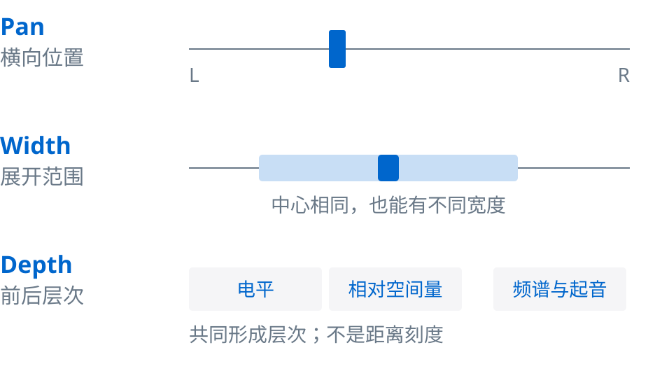
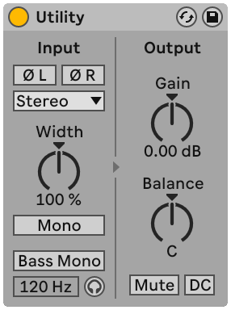
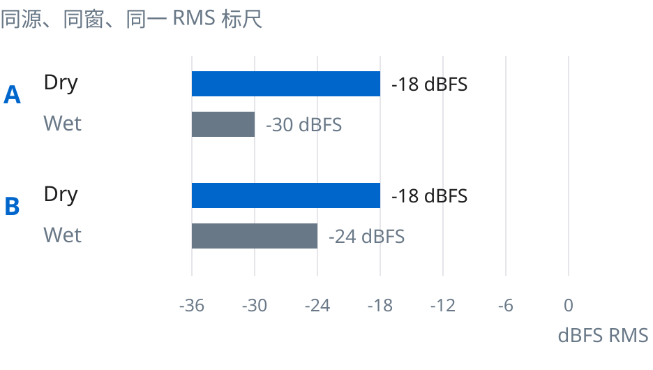
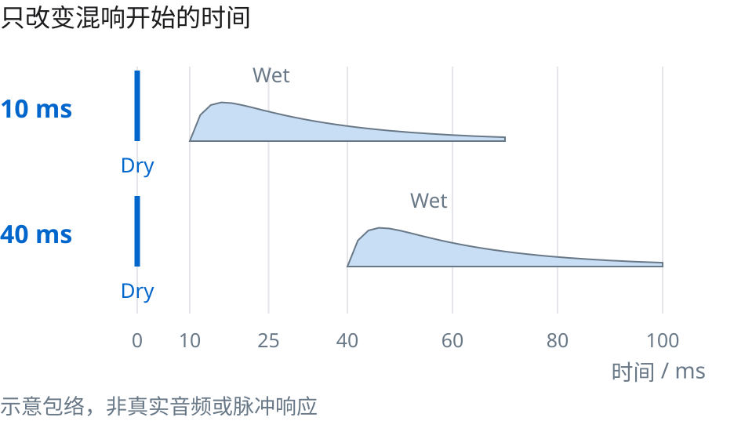
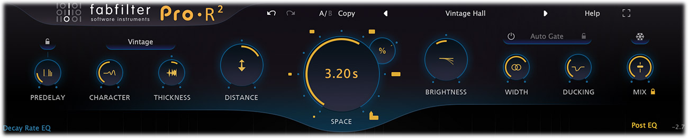
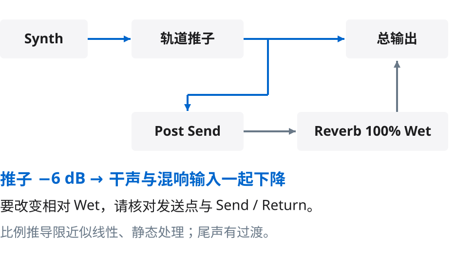
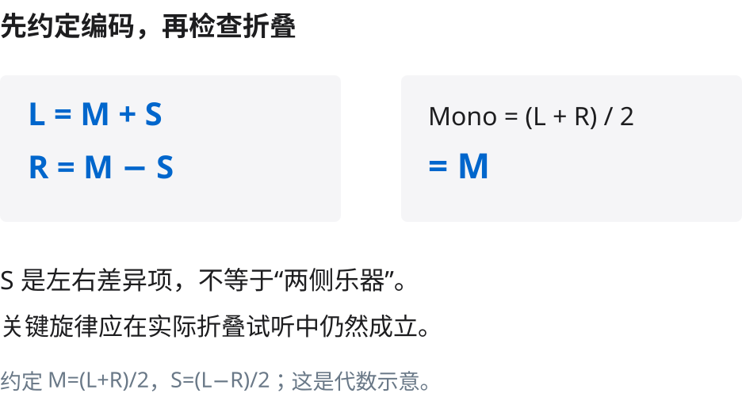
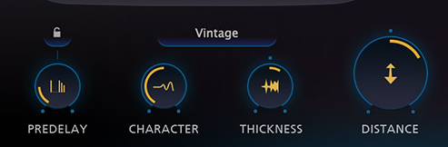
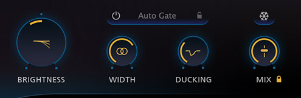

# 合成器的左右宽度与前后层次

Kangdi Wang

这份报告面向已经能在 DAW 中调推子、Pan 和混响，但一加合成器就觉得拥挤的制作人。读完后，你可以分别决定一个声部的横向位置、立体声宽度和前后层次，并通过整曲及单声道检查验证选择。

核心结论是：先确定音乐角色，再分别处理位置、宽度和深度。深度不是 Pan 的另一个方向，也不能由某个混响百分比换算成几米。这里讨论的是普通双声道混音的感知层次，不是双耳渲染、Atmos 对象坐标或真实房间的声源定位。


图 1 为 AI 生成的概念插画。清晰蓝色带与柔化背景仅用于提示听感对比，不是声波、频响、音频测量或物理声场模拟。

## 先把三件事分开

Pan（声像位置）决定声音在左、右之间的分配。Stereo Width（立体声宽度）描述或改变声像展开的程度。Depth（前后层次）是听者从电平、频谱、直达声与空间成分等线索共同形成的判断。一个声部可以宽而靠前，也可以窄而靠后；“居中”也不自动等于“贴脸”。这三个维度可以一起听，但不能用同一个旋钮含义替代。[S1、S2、S6]



图 2 是独立绘制的决策示意。图形长度、位置和灰度没有声学单位，不是坐标到参数的映射。

先问音乐角色：Lead（主旋律音色）是不是当前焦点？Pad（持续铺底音色）是否只需提供和声？Arp（琶音）是否承担节奏或问答？角色来自当前段落，副歌的 Lead 可以在主歌退成背景。把每个角色都推到最响、最亮、最宽，通常会消耗对比，未必形成更有层次的编配。这里的“通常”是试听策略，而非自然定律。

## Pan 与 Balance 需要先看路由

单声道源经 Pan 分配到 L/R，与立体声源上的 Balance 并不是完全一样的操作。Balance 通常改动两个现成声道的相对电平；朝左调时，右声道里独有的演奏或效果可能变小，而不是完整搬到左边。某些 DAW 的 Stereo Pan 或双声道独立 Pan 能改变左右输入各自的输出位置。名称和实现依 DAW 而异，先查模式，不把所有标为 Pan 的控件当同一算法。[S1、S3]

Ableton Live 12 的官方手册明确区分 Stereo Pan Mode 与 Split Stereo Pan Mode。后者能分别调整左右输入声道的位置。对已有 Unison、Chorus 或立体声 Delay 的合成器，先听左右到底包含什么，再决定用哪一种。硬偏一边不是错误，但可能改变音色与能量分布。



图 3 是 Ableton Live 12 手册的 Utility 真图。界面显示 Stereo 输入、Width 100%、Gain 0.00 dB、Balance C；Mono 和 Bass Mono 未高亮。图中 120 Hz 只是 Bass Mono 频率显示，不表示该处理正在启用。它只用于找控件，不是一组推荐设置；原始文件及校验见 assets.json。[S2]

Utility 中 Width 与 Balance 分开，是一个有用的视觉提醒。对这个设备，Width 0% 合为单声道，超过 100% 加宽。但这个百分比定义不能移植到其他插件。单声道素材的 L 与 R 完全相同时，纯 M/S 的 Side 增益没有可放大的差异；要创造新的左右差别需要额外处理，而额外处理又要检查单声道后果。

## 深度由多个线索共同形成

电平较低、较少突出高频、相对更多空间成分，常能让一个声部更退后。这是相对同一首混音的可用方法，不是“降低 3 dB 就后退一米”。声源本身的音色、演奏、编配遮蔽以及监听环境都能改变结果。特别是合成器没有一个固定的自然参考音色：暗的 Lead 仍可能很靠前，亮的 Pad 仍可能处于背景。[S6、S8]

早期反射（Early Reflections）是原声之后较早到达的反射成分，随后才是更密集的后期混响。它们的时间分布和强弱能够提示空间特征。更响的早期反射不在所有算法里都意味着“更远”：FabFilter Pro-R 2 在 Distance 低值时，反而描述为较明亮、较突出的早期反射。因此，不能把单个反射量当成通用距离滑杆。[S4、S5]

真实房间中的 Direct-to-Reverberant Ratio（DRR，直达声与混响能量比）是物理量。AES 的原始讲义提醒，距离感还依赖声源和房间经验。DAW 的 Dry/Wet 旋钮不是 DRR 表，发送推子也不是 DRR 表：插件增益、干湿混合规律、预置、滤波和测量时间窗都影响结果。[S8]

## 一个可以复核的干湿电平例子

假设同一个合成器短句分别送入干声总线和完全湿声总线，用同一种 RMS 算法、同一时间窗、同一数字参考，得到以下人为构造读数。这些数值不是录音实测，也不等于房间 DRR。

- 条件 A：Dry = −18 dBFS RMS，Wet = −30 dBFS RMS。两支路电平差为 12 dB，湿声 RMS 幅度约为干声的 10^(−12/20) = 0.251 倍。
- 条件 B：Dry 仍为 −18 dBFS RMS，Wet 提到 −24 dBFS RMS。差值成为 6 dB，湿声幅度约为 0.501 倍。
- 这意味着本例湿声幅度增加约 2 倍；不意味着“距离增加 2 倍”或听感增加 2 倍。混合后的总 RMS 还包含两支路相关性，不能把 −18 与 −24 直接相加。[本文代数]



图 4 共用 −36 至 0 dBFS RMS 数轴。只对构造的支路读数作图，不显示伪造的音频波形或听感量表。

实际操作时，先在伴奏中缓慢升高 Wet，判断音符边界和角色是否仍清楚；再适当匹配 A/B 总输出响度，减少“更响所以更好”的偏差。若只是尾巴更大、主体仍然抢前，继续加 Wet 未必解决问题，应检查干声电平、频谱与编配。

## Pre-Delay 先解决起音与空间的相对时间

Pre-Delay（预延时）控制原声与混响开始之间的间隔，具体延迟哪些成分需要查产品。Ableton Reverb 的 Predelay 对应第一批早期反射前的延迟；FabFilter Pro-R 2 描述为原声与混响开始的初始间隔。它不是 Decay（衰减时长）。[S4、S5]

较长的预延时可以让干声起音先出现，同时在后面保留空间尾声。因此“大空间在后面、主体仍靠前”完全可能。这也说明“预延时越长，声音越远”不可靠。[S7]



图 5 用同一时间轴比较 10 ms 与 40 ms 的人工示意，湿声形状只是抽象包络，不是实际脉冲响应。两者只用于理解“开始时间”改变，不代表建议的前后配方。使用 48 kHz 采样率时，10 ms = 480 samples，40 ms = 1920 samples，差 1440 samples。公式为 samples = ms × 48000 / 1000。

如果 40 ms 的混响使快速琶音听成松散的第二次起音，就应缩短。持续 Pad 未必像 Pluck 一样能清楚暴露这段间隔。可以尝试 10、25、40 ms 的有序对比，每次固定其他参数，并把它视作实验起点，不能当成适用所有音色的模板。

## 真实插件里哪些控件分别负责什么



图 6 来自 FabFilter Pro-R 2 官方帮助页面。截图为 Vintage 风格，顶部预置名 Vintage Hall，Space 显示 3.20 s，Mix 锁图标可见。大多数旋钮没有数值读出，不能根据角度猜数值。此图不是本报告的试验工程，也不是推荐预置。原色及数值均未重绘。[S4]

- PREDELAY：干声与混响开始的时间间隔。
- DISTANCE：该算法对接近或远离声源的综合建模，不能读取为实际米数。
- BRIGHTNESS：混响的明暗平衡。这里改的是混响，不必然等于合成器干声变暗。
- WIDTH：此产品的混响宽度控制，内部还涉及声道联动和交叉馈送，不能等同 Utility 的 Width。
- MIX：最终干湿关系。放在常规并行 Return 上时，按手册设为 100%，由发送或返回电平控制湿声量。

先让读者在真实界面找到对象，再讨论不同作用，比用一张自造“万能插件”图更可复核。产品图只为当前功能说明提供必要证据，不构成推荐购买或厂商背书。

## 路由会改变你以为的前后动作

常规并行混响可以写为：Synth → 干声输出；同时通过 Send → Reverb 100% Wet → Return → 总线。通过 Return 可单独改变空间成分，但需要留意是否被多个声部共用。[S1、S4]



图 7 特别标出发送点。在 Post-Fader 发送且后续处理近似线性、静态的条件下，只把轨道推子降低 6 dB，干声和送往混响的信号通常一起降低约 6 dB，稳定段的干湿比例不会自动变得更湿；旧尾声仍有过渡过程。如果希望背景角色相对更湿，要调整 Send/Return 关系。Pre-Fader 则可能让干声下降而发送不变，效果取决于 DAW 的具体取点。压缩、饱和、Ducking、自动化和混响状态会破坏简单比例推导。

另外，不同 DAW 的发送是否跟随 Pan、插件在推子前后以及立体声到单声道路由，都需要确认。不能仅凭一个接线箭头推断整套工程。

## 从一段编配开始做角色分配

以下是一份试听实验，不是已经测量过的结果，也不是预置表。先复制工程状态，再循环同一段。

1. Lead 保持主要旋律的清晰度。先听居中或轻微偏移，减少无目的加宽；Wet 从能听见空间但不遮住音头的位置开始。
2. Pad 承担和声包围。先比基准降低约 3 dB，听它是否仍支撑情绪；如有必要，试高架 EQ −2 dB 的轻微调整，再增加一点相对 Wet。3 dB 与 2 dB 均为本次建议的实验步长，不是目标读数。
3. Arp 与 Lead 争抢时，先错开音域或节奏，再试听向左或向右的摆位。对立体声 Arp，先核对 Balance 与 Stereo Pan；不能假设一个旋钮会完整移动全部内容。
4. 三个声部一起听。宽度要分配给需要横向展开的角色，不能用“都拉满”替代编配。主旋律过薄时先恢复重要的中心内容，再判断是否仍需要效果。

每完成一步就保存一个可退回的状态。最好一次只改一个变量；在初步找到方向后，才把多个线索协调起来。

## 单声道检查为什么必做

采用 M = (L + R)/2、S = (L − R)/2 的约定，可以还原 L = M + S、R = M − S。于是折叠为 (L + R)/2 时得到 M，差异项 S 抵消。这是代数恒等式，不是把“Side 等于两侧乐器”当成事实。[S9；缩放约定及推导为本文]



图 8 不对应任何实际音频。如果某个合成器的关键质感主要依赖 L/R 相反的成分，折叠后可能明显改变。可逆的 M/S 编码本身不丢信息；真正要审查的是加宽、时间差、反相等处理后，重要内容是否仍能在目标播放方式下成立。相关度表可辅助定位，短暂负相关并不自动证明不合格。[S10]

检查时合并 L+R，不是只关闭右音箱。确认折叠增益规则，避免把单纯增益差误判为音色损失。听旋律是否变小或消失、低频是否变空、Pad 是否遮住主体；问题出现时，依次旁路 Unison、Chorus、Delay 和加宽处理，找出来源。

## 一次可复用的试听顺序

先关空间效果，定角色、电平和左右。再调宽度，看是否挤占其他声部。随后加相对 Wet，单独比较早期反射与尾声；用预延时保护需要清晰的音头，用频谱处理降低不必要的争抢。最后在整曲中匹配响度 A/B，折叠单声道，再回到立体声。

结束标准应写成“旋律清楚、铺底仍有作用、左右不失衡、折叠后关键内容可用”，不要写成“距离刚好五米”。一个处理如果在 Solo 中很壮观，但使整曲焦点模糊，就没有完成它的任务。

## 真实界面的局部核对



图 9a 是图 6 的未改字局部。左边 PREDELAY 负责开始间隔，右边 DISTANCE 调整算法里的空间线索；中间 CHARACTER 与 THICKNESS 是其他控制。此图只用于辨认对象，不把旋钮角度换成未显示的参数值。



图 9b 同样从图 6 精确裁切。BRIGHTNESS 是混响明暗，WIDTH 是混响展开，MIX 是干湿关系。DUCKING 是另一个独立控制，本篇没有实际调试或声称其效果。图片原色及像素保留，裁切坐标和校验见 assets.json。[S4]

## 证据与权利说明

本报告的参数例子均已注明为数学构造或试听建议，没有输入音频、实际插件工程或监听测试，不承诺更宽、更远或更专业。可编辑 SVG 为原创解释图；AI 插画为概念表现。Ableton 与 FabFilter 官方界面图保留真实像素，仅围绕相关控件作教育评论；权利属于各厂商，未获得一般性商业再许可或无条件转载许可。详细来源、裁切、状态、文件校验和限制见 assets.json 与 RIGHTS.md。开源代码许可不覆盖第三方界面图。

## 参考资料

[S1] [Ableton Live 12 Mixing](https://www.ableton.com/en/live-manual/12/mixing/)

[S2] [Ableton Live 12 Utility](https://www.ableton.com/en/live-manual/12/live-audio-effect-reference/#utility)

[S3] [Apple Logic Pro Pan and Balance](https://support.apple.com/guide/logicpro/set-channel-strip-pan-or-balance-positions-lgcpbc21a438/mac)

[S4] [FabFilter Pro-R 2 Main controls](https://www.fabfilter.com/help/pro-r/using/maincontrols)

[S5] [Ableton Live 12 Reverb](https://www.ableton.com/en/live-manual/12/live-audio-effect-reference/#reverb)

[S6] [iZotope Mix Depth](https://www.izotope.com/community/blog/what-is-mix-depth-how-to-create-front-back-space)

[S7] [iZotope Reverb Pre-Delay](https://www.izotope.com/community/blog/reverb-pre-delay)

[S8] [AES Tutorial by Ville Pulkki](https://www.aes.org/technical/documentDownloads.cfm?docID=551)

[S9] [FabFilter Mid/Side processing](https://www.fabfilter.com/help/pro-g/using/midsideprocessing)

[S10] [iZotope Ozone 8 Imager](https://downloads.izotope.com/docs/ozone8/imager/index.html)

## 完整图文与可编辑源码

https://github.com/DDDPG/music-mixing-secrets

```bibtex
@misc{wang2026musicmixingsecrets,
  author = {Kangdi, Wang},
  title = {Music Mixing Secrets},
  year = {2026},
  url = {https://github.com/DDDPG/}
      # {music-mixing-secrets}
}
```
