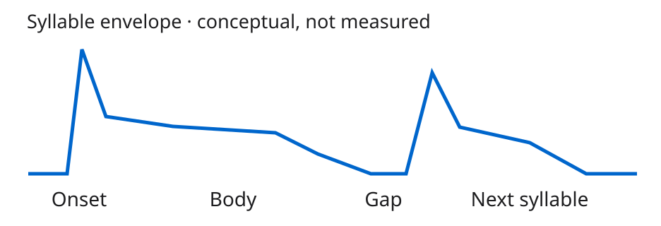
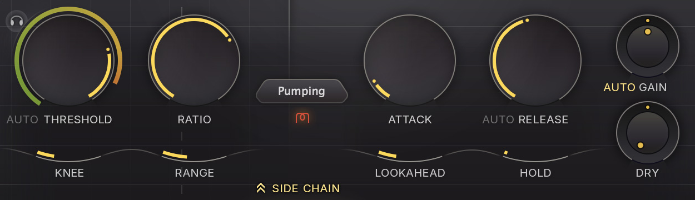
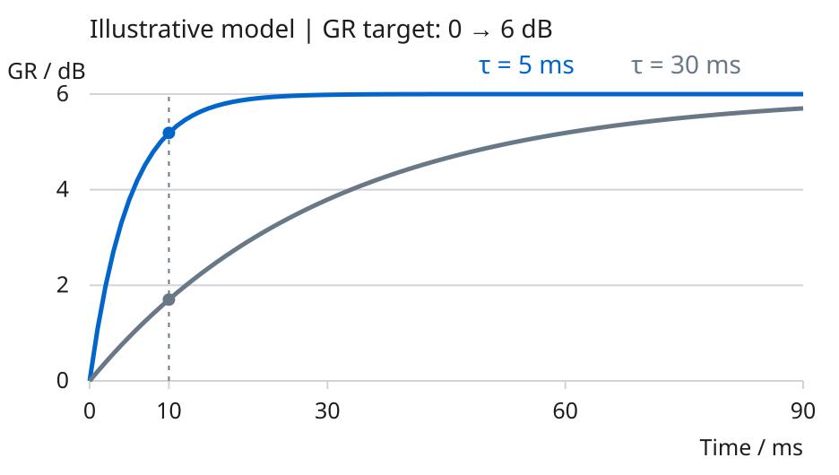
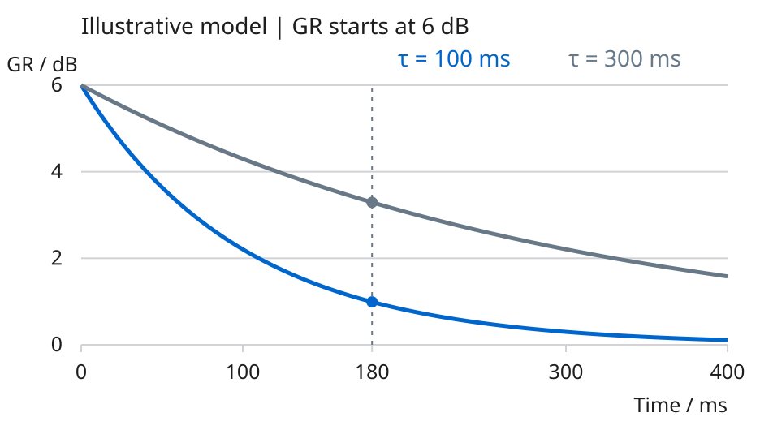
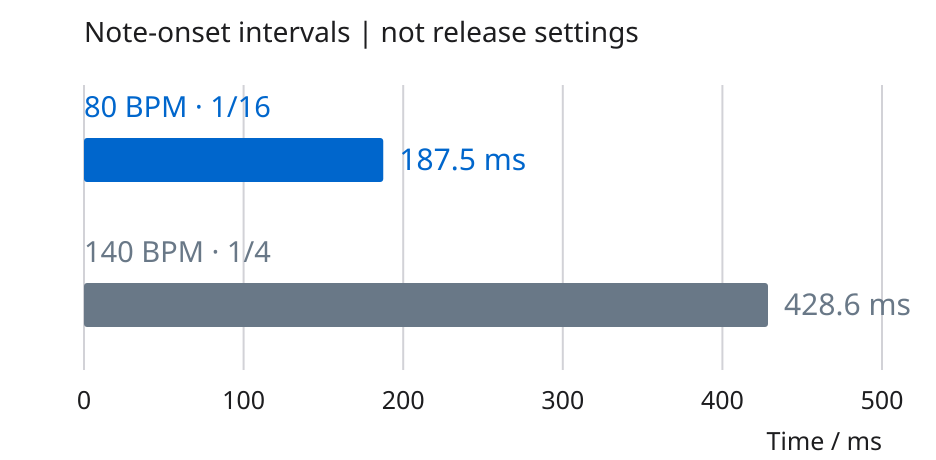

# 人声压缩塑形研究报告

## 先听字头和字身之间的关系

人声压缩既能控制电平，也会改变一句话内部的力度轮廓。想让唱腔更有棱角，可以尝试保留更多起音相对于后续字身的突出程度；想让它更平顺，可以尝试更早地控制突出的起音。这是有条件的试听方向，不是“慢 Attack 一定更有攻击性”的声音定律。原始演唱、辅音、元音、爆破音、齿音、伴奏掩蔽和压缩量都会改变判断。

本报告面向已经会插入 Compressor、但容易只盯着 Gain Reduction 表的混音者。目标是让读者分开听三个位置：字头、字身、下一个音节。示例对象是 FabFilter Pro-C 3；数学图是独立的教学模型，不是该插件的测量结果，也不是对其内部算法的复刻。没有提供音频，因此这里没有“实测改善”、试听前后结果或通用人声预设。

图 1 把一个音节分成起音、字身、间隙和下一音节，仅帮助定位听觉注意力。线形不是录音波形，没有真实振幅或时间测量含义。英文 Onset、Body、Gap、Next syllable 分别对应这四个位置。

## 实际控件分别负责什么

图 2 为 FabFilter 官方产品页提供的 Pro-C 3 截图，保留原始比例和像素内容。图中显示 Nice Pumping 预设、Pumping 风格，以及 AUTO RELEASE 和 AUTO GAIN 控件；RELEASE 旁的 AUTO 为灰色，GAIN 旁的 AUTO 为黄色。它用于识别真实产品及控件，不是建议的人声设置；显示屏中的信号和红色曲线也不是本报告的实验。具体小版本及通道组件未在该图上明确标注。[1][2]

图 3 是图 2 的精确矩形裁切。THRESHOLD、RATIO 决定检测条件与静态输入输出关系；ATTACK、RELEASE 影响增益变化速度；KNEE 影响阈值附近过渡；RANGE 限制可施加的增益变化深度。AUTO RELEASE 是 Release 的自动模式开关。右侧图上标签是 AUTO GAIN；手册将调节压缩后电平的旋钮称为 Wet Gain，它承担补偿增益的功能。旁边的 DRY 加入未经当前压缩处理的信号。[2][3]

理解 Ratio 时，先用一个稳态、硬拐点、无补偿增益的向下压缩算例。Threshold 为 −18 dBFS，输入为 −10 dBFS，则输入高出阈值 8 dB。Ratio 为 4:1 时，阈值以上只保留 8 ÷ 4 = 2 dB，输出为 −18 + 2 = −16 dBFS，增益衰减量为 6 dB。这不代表整段音量“除以四”；瞬态阶段、Soft Knee、不同检测方式和风格会改变实际响应。[3]

GR 是 Gain Reduction，即增益衰减量。本报告用正数表示“降低了多少 dB”；例如 GR = 6 dB，增益变化为 −6 dB。它不是输出电平或主观响度。请同时看清插件表头的符号约定，避免把曲线方向读反。

## Attack 调的是建立衰减的速度

Attack 不等于先等待一段时间，再突然开始压缩。它描述增益衰减如何随信号变化而建立。较慢的响应常让快速起音相对于字身保留得更多；较快的响应常使起音收敛。若起音已很尖或爆破音很突出，保留它并不一定有利。若连续音节之间一直有明显衰减，单独放慢 Attack 也不会保证每个新字头都重新“放行”。[4][5]

图 4 使用一个故意简化的一阶模型：目标 GR 在 t = 0 从 0 跳到 6 dB 后保持不变，实际 GR(t) = 6 × [1 − exp(−t/τ)] dB。横轴是经过时间，纵轴是正值衰减量。蓝线 τ = 5 ms，灰线 τ = 30 ms。两条线都从起点连续改变，而不是保持不动直到 5 或 30 ms。

在 t = 10 ms：蓝线为 6 × (1 − exp(−2)) ≈ 5.19 dB，灰线为 6 × (1 − exp(−1/3)) ≈ 1.70 dB。在这一个模型里，较慢响应在起初十毫秒施加的衰减更少。τ 是模型时间常数；在 t = τ 时，曲线达到目标的约 63.2%，并非已经“压完”。这只是算式的性质。

重要边界：该模型把平滑施加在 dB 域的 GR 上，忽略检测器、Soft Knee、Lookahead、Hold、失真和随素材变化的时间行为。这里的 τ 不能直接当成 Pro-C 3 的 ATTACK 旋钮值。官方手册明确说明，不同风格具有各自的 program-dependent 行为；旋钮同为 10 ms，也不意味着不同压缩器会绘出同一条曲线。[2]

实践时，固定模式和其他条件，来回比较较快、较慢的 Attack。听“字头是否变钝、尖峰是否失控、字身是否仍然稳”。所谓“不能压死”不只由 Attack 决定：Threshold 太低、Ratio 太高、持续 GR 太深、Release 尚未恢复，都可能使演唱缺乏起伏。

## Release 决定衰减怎样恢复

Release 是压缩器从增益衰减恢复的速度，不是人声尾音长度，也不是歌曲中两个字之间的固定等待。实际释放可受风格、当前 GR、前面信号持续时间和 Auto 模式影响。Pro-C 3 的手册说明其多种风格采用不同的释放模型，短瞬态后和长期压缩后的恢复可能不同；开启 Auto Release 后，Release 旋钮仍会影响自动释放的整体行为。[2]

图 5 假设恢复开始时 GR = 6 dB，此后目标立即降为 0，并在 180 ms 的观察窗口内持续为 0，没有再触发，也没有 Hold。模型为 GR(t) = 6 × exp(−t/τ) dB。蓝线 τ = 100 ms，灰线 τ = 300 ms。180 ms 后分别为 6 × exp(−1.8) ≈ 0.99 dB 和 6 × exp(−0.6) ≈ 3.29 dB。

这个对比回答的是“同一恢复窗口结束时，还剩多少衰减”，不是“人声应该设成多少毫秒”。180 ms 从释放开始计算；它不是默认的字头间隔。若前一个元音仍持续触发压缩，真正留给恢复的时间可能远少于两次起音之间的间距。

较快恢复能让后续字身或间隙更快回到原来的增益，但也可能带来不希望的忽大忽小、呼吸感或失真。较慢恢复有时更连贯，却可能把下一个字头一起压住。这两种现象都要放回伴奏判断。某些持续、平稳的压缩目标本来就允许 GR 不完全回到零；“每个字前必须清零”也不是普遍标准。[4][5][6]

## 歌曲速度不是 Release 的唯一依据

“慢歌不能快释放，快歌不能慢释放”过于绝对。歌曲速度只告诉我们拍子的时间尺度；唱词密度、切分、连音和真正停止触发的位置才决定局部恢复机会。为了持续平顺地控电平，快歌也可能采用较慢或自动释放；为了处理分散的短峰值，慢歌也可能需要较快恢复。最终还要服从目标和副作用。[5][6]

图 6 使用同一个线性毫秒轴比较两种假设的音节节奏。四分音符时长为 60,000 ÷ BPM ms。80 BPM 的十六分音符间隔为 60,000 ÷ 80 ÷ 4 = 187.5 ms；140 BPM 的四分音符间隔为 60,000 ÷ 140 ≈ 428.6 ms。较慢的歌曲若唱得更密，音节起点反而可能更靠近。

这些数值只描述假设中按网格排列的起音间隔。真实演唱不必落在网格，Release 也无需机械地等于某个音符时长。即使两次起音隔了 428.6 ms，也可能因长元音持续触发而几乎没有无触发间隙。把节拍换算当作时间参照，再看 GR 的恢复并听上下文。

## 一次只改一件事的试听流程

1. 选一句有强弱、有连续字头、又有句尾的人声，循环播放。先在伴奏中确认真正的问题：字头太冲、字身不稳，还是下一字被压住。极端单词电平差可先用 Clip Gain 或音量自动化整理，不要求一个压缩器包办所有问题。
2. 使用同一压缩风格，固定检测、Knee、Lookahead、Hold、侧链和并行比例。学习时可暂时关闭 Auto Release、Auto Gain 与额外的 DRY 路，让变量更容易听懂；随后可重新试用自动模式。这是实验控制方法，不是对自动模式的否定。
3. 先获得可听见但可接受的压缩量，再比较 Attack。比如用 3:1 作临时 Ratio，把 Threshold 调到强字出现几 dB 的 GR；在 5 ms 与 30 ms 之间往返听字头，找到方向后再细调。数值是练习对照点，既非通用起点，也不保证对应上面的 τ 模型。
4. 固定 Attack，再比较 Release。比如在 80 ms 与 250 ms 间往返，听句尾的起伏、呼吸和下一字的开头。必要时改变范围；遇到 program-dependent 风格，不能只凭标称毫秒值猜实际恢复轨迹。
5. 每次切换处理与旁通，都用输出补偿把主观响度尽量匹配，再回到伴奏判断。不要因为压缩后更响就判定更好。Pro-C 3 的 Auto Gain 并非实际测量响度后做严格匹配，官方也提示可能仍需手动微调。[2]

这套流程的目标是建立听觉对照。不存在必须达到的 GR 数字；不同演唱与目标需要不同程度的控制。保存版本时记录模式和状态，避免把不同风格、Auto 状态和响度变化混成 Attack/Release 的单一效果。

## 用现象决定下一步

- 字头变钝：先试放慢 Attack，或减少持续 GR；若前一个字尚未恢复，还要检查 Release。不要把所有清晰度问题都归因于 Attack。
- 字头尖、爆破音突出：尝试更快的 Attack 或针对性 Clip Gain，检查录音本身；齿音问题可另外判断是否需要 De-esser，不要强迫整个人声随每个齿音大幅下压。
- 音量细碎起伏、呼吸被抬起：试慢一点的 Release 或减少压缩量，同时检查补偿增益、噪声与原始呼吸。
- 下一字持续发闷：看它到来时 GR 是否仍较深，尝试更快的 Release、较浅压缩或不同风格。若当前目标就是连贯的电平控制，残留 GR 未必是问题。

最后问三个问题：字头是否符合唱腔？字身是否稳定？下一句是否自然？能够回答这三点，比记住“某类歌曲配某个毫秒数”更有迁移价值。

## 可复核资料与素材使用边界

[1] [FabFilter Pro-C 3 官方产品页](https://www.fabfilter.com/products/pro-c-3-compressor-plug-in)。产品身份、官方截图入口。图上状态不作为本报告的参数建议。

[2] [FabFilter Pro-C 3 Time controls](https://www.fabfilter.com/help/pro-c/using/timecontrols)。Attack、Release、Auto Release、Lookahead、Hold、Wet Gain、Dry Gain、Auto Gain 和 program-dependency 的产品特定说明。

[3] [FabFilter Pro-C 3 Dynamics controls](https://www.fabfilter.com/help/pro-c/using/dynamicscontrols)。Threshold、Ratio、Knee、Range 的产品特定定义。

[4] [FabFilter Learn Basic compressor controls](https://prod.fabfilter.com/learn/compression/basic-compressor-controls)。响应速度、瞬态关系、恢复与下一事件的关系，以及按耳朵调节的条件。该教程含 Pro-C 2 实例，仅用于一般原理，不用于 Pro-C 3 的界面识别。

[5] [iZotope What Is Audio Compression](https://www.izotope.com/community/blog/what-is-audio-compression)。明确区分反应速度与等待；讨论 Release 与节奏、速度、信号类型、目标之间的关系。

[6] [Ableton Live 12 Audio Effect Reference Compressor](https://www.ableton.com/en/manual/live-audio-effect-reference/#compressor)。Attack/Release、过快释放的副作用、Lookahead 和不同包络响应。这里不把 Live 参数刻度当成 Pro-C 3 的刻度。

[7] [FabFilter Press Area](https://www.fabfilter.com/press)。官方说明其 press kit 包含 press releases、logos 和截图。提供媒体素材不等于授予任意再发布、商用或再许可权。

所有机制图均为本报告原创概念图或显式数学算例。原始模型数据和公式随可编辑源文件提供。厂商截图保留 © FabFilter 权利；本报告仅作与实际控件直接相关的有限教育性引用，不声称已获得广泛复制、商业利用或将图片按代码许可证再许可的授权。源代码、字体和厂商图片的权利边界分别记录，不能混为一种许可。
